<p align="center">
  
</p>

<h2 align="center">The 4K remux your browser was never supposed to play.<br />Playing. Original file, no transcode, in a tab.</h2>

<p align="center">
  Vela is the home-media client for <b>Ether</b>, <b>Jellyfin</b>, <b>Emby</b> and <b>Plex</b>. It demuxes MKV, decodes HEVC, TrueHD and DTS, tone-maps HDR on the GPU and renders ASS and PGS subtitles <b>inside the browser</b>. It runs a Live TV guide that stays smooth at <b>12,000 channels</b>, and it lets you <b>reskin the entire app</b>, from a printed catalogue to an old CRT in a dark room.
</p>

<p align="center">
  
  
  
  
  <a href="LICENSE"></a>
</p>

<p align="center">
  <a href="#why-vela-exists">Why Vela</a> ·
  <a href="#a-player-that-shouldnt-work-in-a-browser">The player</a> ·
  <a href="#live-tv-at-12000-channels">Live TV</a> ·
  <a href="#nine-apps-in-one-skins">Skins</a> ·
  <a href="#the-ether-protocol">Ether protocol</a> ·
  <a href="#bring-your-own-server">Other servers</a> ·
  <a href="#under-the-hood">Under the hood</a> ·
  <a href="#where-it-stands">Status</a> ·
  <a href="#questions-youre-about-to-ask">FAQ</a>
</p>

<p align="center">
  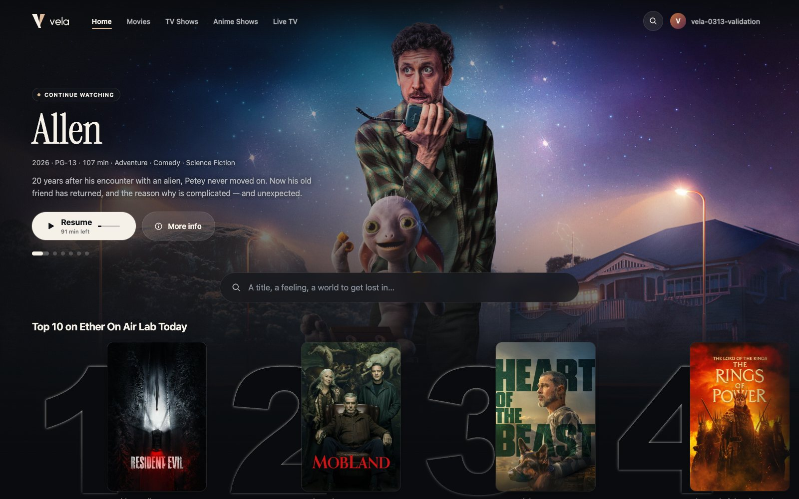
</p>

## Why Vela exists

Every media client makes the same trade. The browser can't play your files, so the server burns a CPU transcoding a 60 Mbps remux into something a `<video>` tag accepts. The guide is a list that hangs when the provider hands you ten thousand channels. And every client looks like every other client, because the layout is code and the code belongs to someone else.

Vela refuses all three.

| What you get | What you stop putting up with |
| :--- | :--- |
| **The original file plays.** MKV, HEVC, 4K, lossless audio, styled subtitles: decoded by your device, in the tab, straight from the server's bytes. | A server pegged at 100% transcoding one stream, image subtitles forcing a burn-in, TrueHD quietly becoming stereo AAC. |
| **A guide that holds a cable company.** 12,000 channels, a week of listings, scrolling at 60 fps. | Guides that page in twenty channels at a time, or freeze while they load the lot. |
| **An app that looks like yours.** Nine complete skins, each a different app, switchable in a click. | One layout for everyone, forever. |
| **One app for every server.** Ether, Jellyfin, Emby and Plex, with a server switcher. | A different client, account and remote for each server. |
| **Playback that recovers.** A failed decoder, path or audio track degrades one step at a time instead of ending the movie. | "Playback error. Try again." |

---

## A player that shouldn't work in a browser

<p align="center">
  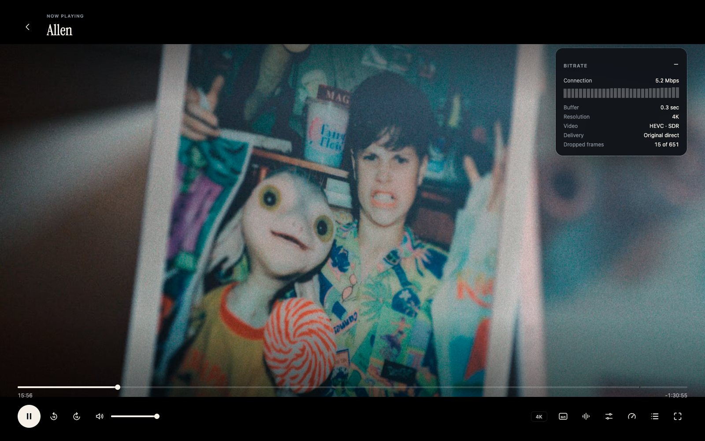
</p>
<p align="center"><sub><b>Not a transcode.</b> A 3840×2160 HEVC Matroska file playing <b>Original · direct</b> in a browser tab, read from the server in byte ranges.</sub></p>

When the browser can do it, Vela doesn't ask the server for a transcode. It asks for the **file**.

* **Matroska and MP4, demuxed in the tab.** Vela reads the original over HTTP `Range` requests in 256 KiB pages, validated against the file's ETag, and pulls frames out with its own streaming Matroska cluster parser alongside Mediabunny. A seek fetches only the bytes it needs. Nothing is remuxed and nothing waits for a download.
* **Video decoded on your hardware.** H.264 and HEVC go to the browser's hardware decoder through WebCodecs. If the browser refuses a stream, a WebAssembly decoder takes over and feeds the same GPU frame pool. Frames are presented by a **WebGPU** renderer, not a `<video>` element.
* **HDR handled.** HDR10/PQ and HLG are tone-mapped to SDR in a WebGPU shader, with the browser's own colour conversion switched off so the image is never mapped twice.
* **Audio a browser has never heard of.** **TrueHD, DTS, E-AC-3 and AC-3** decode in WebAssembly, in hash-pinned decoder packages, and play through an `AudioWorklet` as stereo, 5.1 or 7.1 with a proper downmix and a peak limiter. A custom LGPL FFmpeg build brings **46 decoders** to the tab: FLAC, ALAC, Opus, Vorbis, the WMA family, APE, WavPack, ATRAC and more.
* **Subtitles as authored.** ASS/SSA render with full styling through libass (JASSUB) with a pinned font. PGS Blu-ray bitmaps go through Vela's own streaming decoder. SRT, WebVTT, MP4 text tracks and external files are all handled, and viewers set size, background, colour, position and a timing offset of up to ±10 minutes.
* **Graceful degradation.** If something won't play, Vela steps down instead of giving up: a local decoder retry, then the browser's own HLS, then the next path the server offers on the same timeline, edition and audio track (**direct → remux → transcode**), then an on-demand path. If only the **audio** is the problem, Ether transcodes the audio alone to AAC while the original video keeps playing.
* **Everything a player should have:** a live info card (connection, buffer, resolution, codec, delivery path, dropped frames), chapters, trickplay thumbnails on the scrubber, 0.5–2× speed, trailer previews behind the hero that never count as a play, picture-in-picture where the browser allows it, and full keyboard control (`Space`/`K`, `J`/`L`, arrows, `M`, `I`, `F`).

<table>
  <tr>
    <td width="50%" valign="top">
      <a href=".github/assets/player-subtitles.jpg">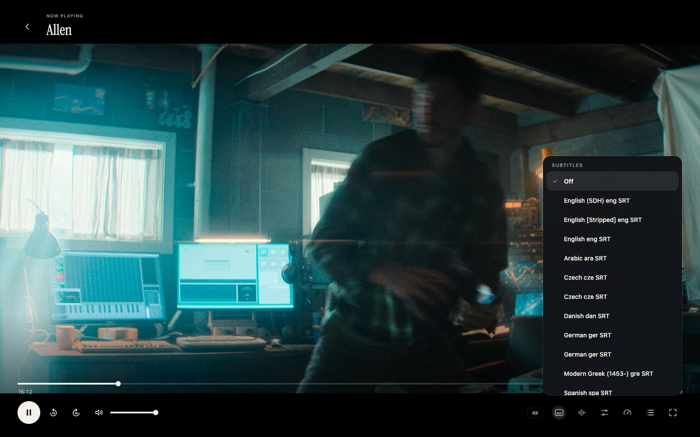</a>
      <p align="center"><sub><b>Every embedded track:</b> dozens of subtitle streams read straight out of the MKV</sub></p>
    </td>
    <td width="50%" valign="top">
      <a href=".github/assets/windows.jpg">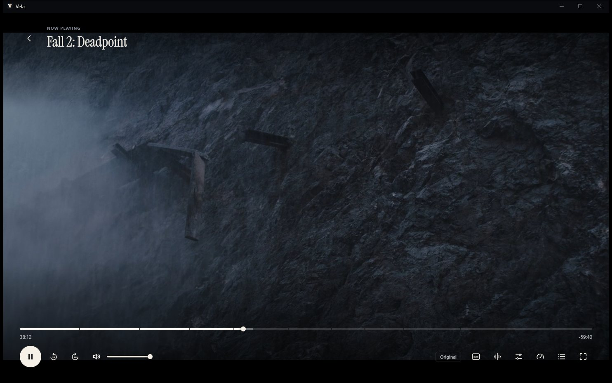</a>
      <p align="center"><sub><b>Vela for Windows:</b> native libmpv underneath, the same Vela player on top</sub></p>
    </td>
  </tr>
</table>

### Native where it counts

On TVs, phones and every desktop, Vela plays through each platform's own engine behind the same player view contract, so every skin's player works unchanged. Each native app has exactly one engine; anything it cannot play falls back to the next path the server offers.

* **Apple TV and iPhone/iPad:** **AetherEngine** (FFmpeg demux, VideoToolbox decode, Apple's own video layer), so colour, HDR10/Dolby Vision, Atmos and frame-rate matching come from tvOS and iOS exactly as in the TV app. Now Playing, remote commands and tvOS **Match Content** included.
* **Android and Android TV:** **Media3 ExoPlayer** with hardware MediaCodec decode, HDR passthrough and Dolby audio passthrough on Android TV, and the LGPL FFmpeg extension for TrueHD, DTS and other audio the device lacks.
* **Windows:** libmpv renders into the window *behind* a transparent WebView2, so the skin's player chrome lies over the native picture. F11 for fullscreen anywhere, the player's own fullscreen button, a dark title bar, and a window that remembers where you left it.
* **macOS (Apple silicon):** **AetherEngine**, the same engine as Apple TV, drawn natively under the Vela player with real EDR HDR on HDR-capable displays.
* **Linux:** **libmpv** (LGPL build) through mpv's render API, with VA-API, VDPAU and NVDEC hardware decode. Runs on glibc 2.35 or newer (Ubuntu 22.04 and later).

---

## Live TV at 12,000 channels

<p align="center">
  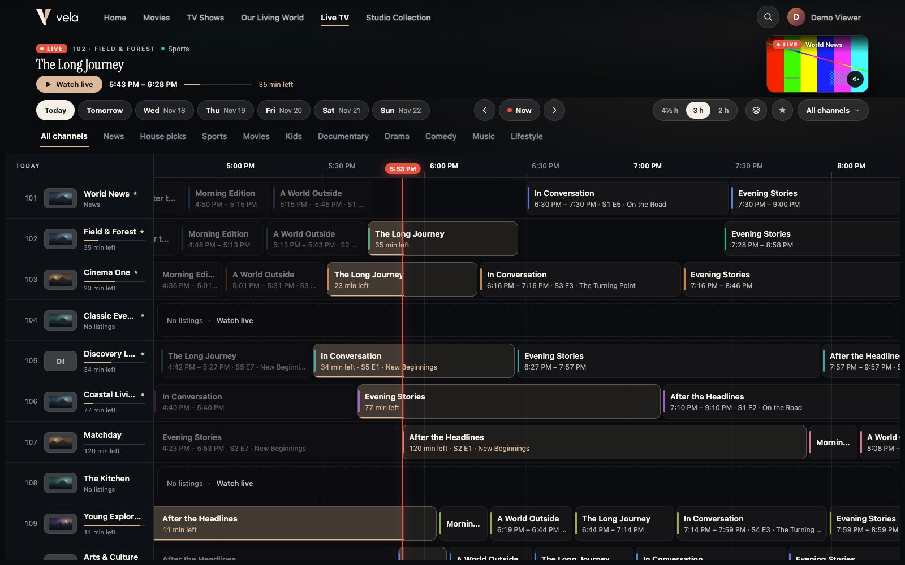
</p>

IPTV lineups are huge, and most guides were built for fifty channels. Vela's grid never loads what you can't see:

* **Windowed loading.** Listings are fetched only for the visible time range, snapped to half-hours, in batches of 100 channels, and refetched 100 ms after you stop moving. The channels you're using stay warm: the one playing, the one you remembered, and its neighbours for zapping.
* **Virtualized in both directions.** Each row draws only the programmes near the visible time. In a **12,000-channel** test lineup, wheel-scrolling held a steady **60 fps** (no frame over 17 ms), jumping to channel 13,829 showed its listings at once, and the page held at about 1,600 elements whether it showed channel 101 or channel 13,829.
* **Built for watching, not just reading.** A muted live preview tile that skips channels that won't play, a mini guide and channel up/down while you watch (it tunes once you pause, not on every press), "Go live" with adaptive latency that tightens only on sustained evidence and backs off on stalls, and a phone-friendly On Now list.
* **Find your way around.** Seven days ahead, three zoom levels (4½ h, 3 h, 2 h on screen), favourites, provider groups, owner-curated guide tabs, programmes colour-coded by genre, and search that returns channels and programmes on now and coming up.

<table>
  <tr>
    <td width="50%" valign="top">
      <a href=".github/assets/guide-12k.jpg">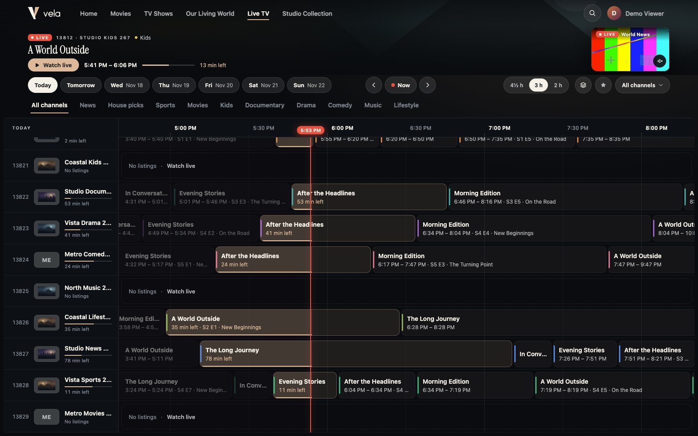</a>
      <p align="center"><sub><b>Channel 13,829 of 12,000:</b> the bottom of the lineup, listings already there</sub></p>
    </td>
    <td width="50%" valign="top">
      <a href=".github/assets/broadcast-live.jpg">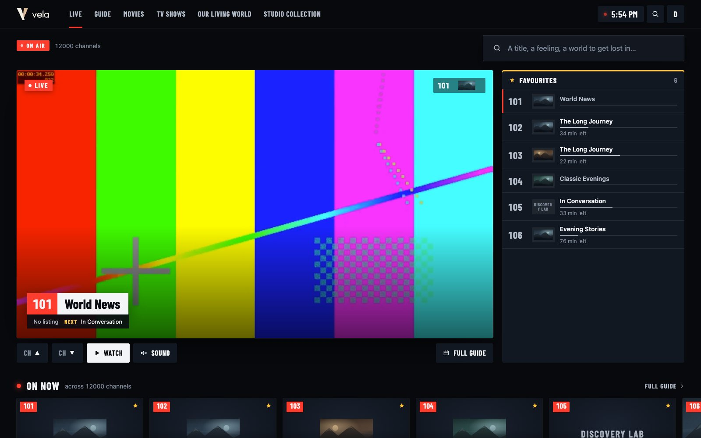</a>
      <p align="center"><sub><b>Broadcast skin:</b> Live TV first, the channel on air, your favourites beside it</sub></p>
    </td>
  </tr>
</table>

---

## Nine apps in one: skins

<p align="center">
  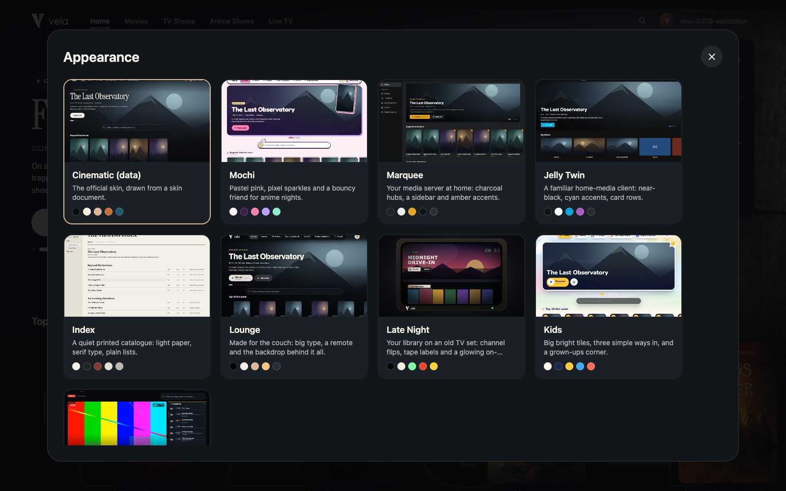
</p>

A Vela skin isn't a colour theme. It's the **whole app**: the layout of home, title pages, search, the guide, the sign-in page and the player, all redrawn. Pick one in **Profile › Appearance** and everything changes in place.

<table>
  <tr>
    <td width="50%" valign="top"><p align="center"><sub><b>Cinematic.</b> The house style: full-bleed art, serif titles, a ranked Top 10</sub></p></td>
    <td width="50%" valign="top">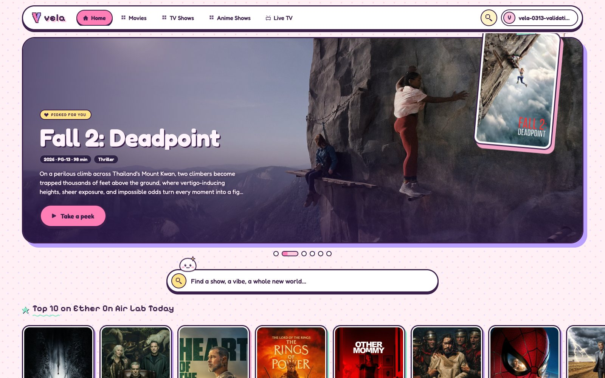<p align="center"><sub><b>Mochi.</b> Pastel pink, pixel sparkles and a bouncy friend for anime nights</sub></p></td>
  </tr>
  <tr>
    <td width="50%" valign="top">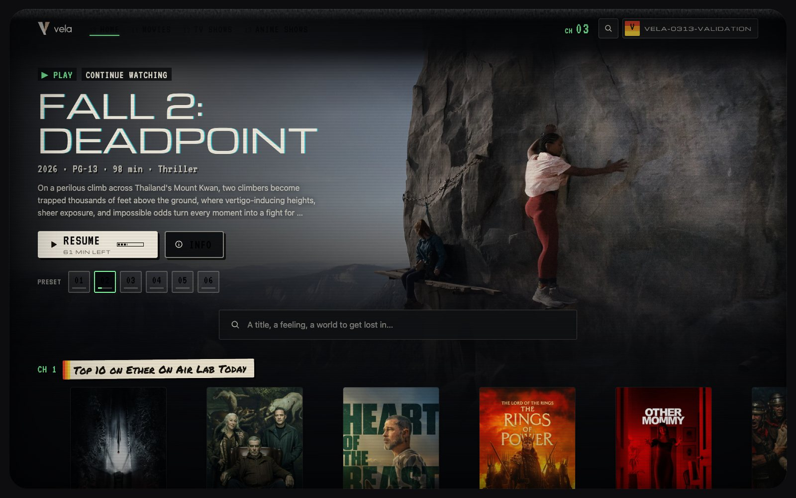<p align="center"><sub><b>Late Night.</b> Your library on an old TV set: channel flips, tape labels, a glowing on-screen display</sub></p></td>
    <td width="50%" valign="top">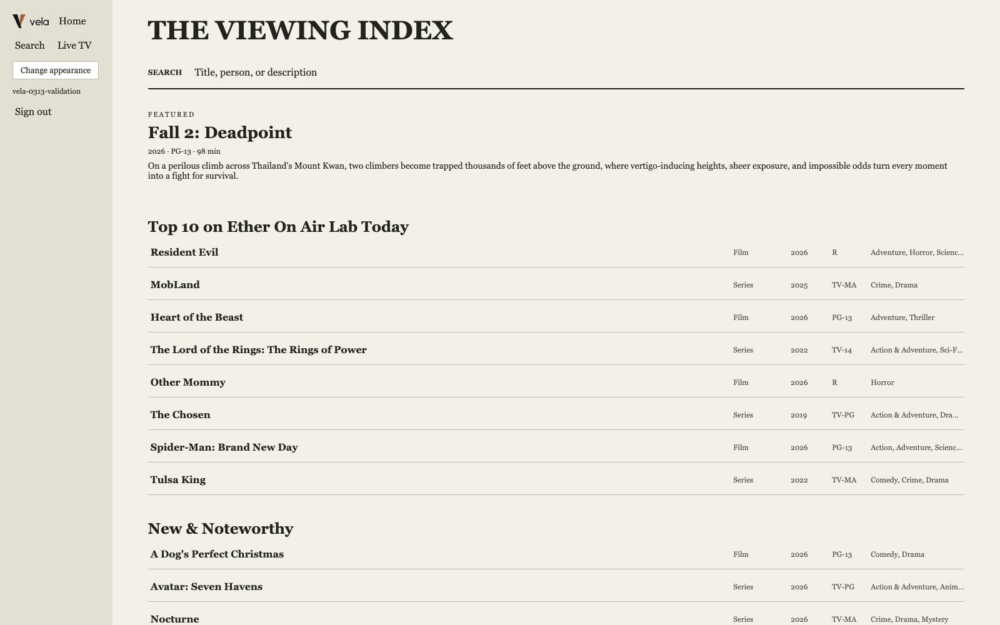<p align="center"><sub><b>Index.</b> A quiet printed catalogue: light paper, serif type, plain lists</sub></p></td>
  </tr>
  <tr>
    <td width="50%" valign="top">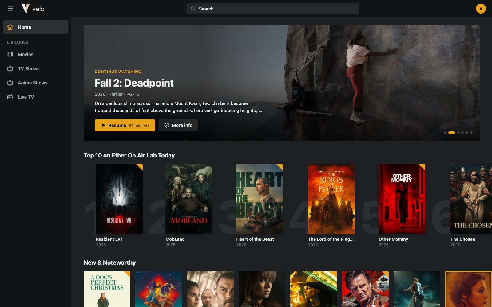<p align="center"><sub><b>Marquee.</b> A media server at home: charcoal hubs, a sidebar, amber accents</sub></p></td>
    <td width="50%" valign="top">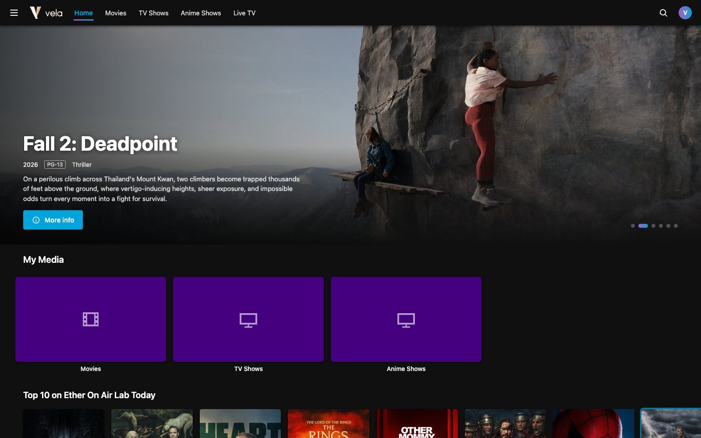<p align="center"><sub><b>Jelly Twin.</b> A familiar home-media client: near-black, cyan accents, card rows</sub></p></td>
  </tr>
  <tr>
    <td width="50%" valign="top">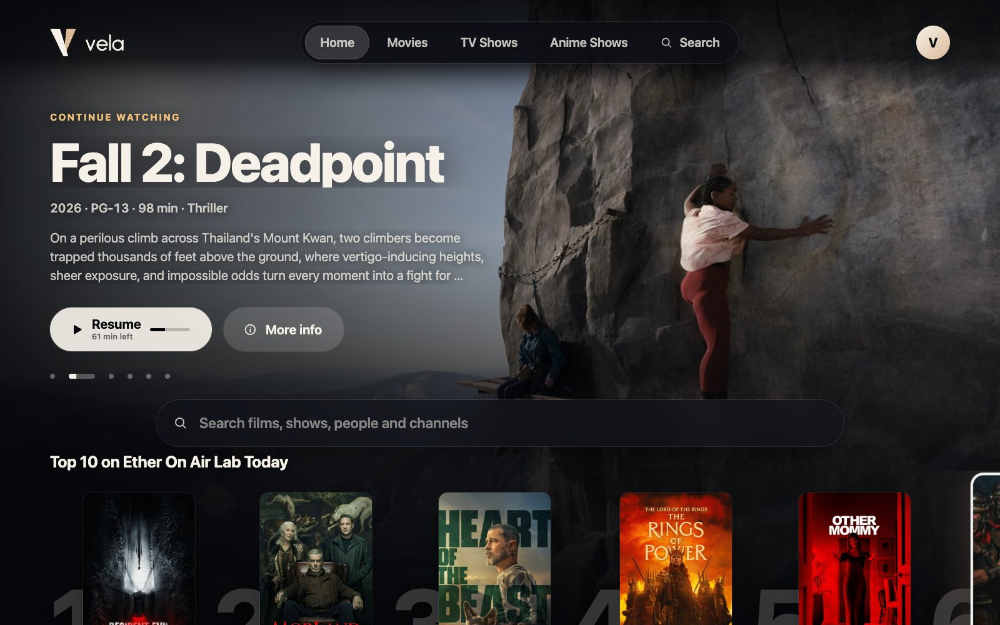<p align="center"><sub><b>Lounge.</b> Made for the couch: big type, a remote, the backdrop behind it all</sub></p></td>
    <td width="50%" valign="top">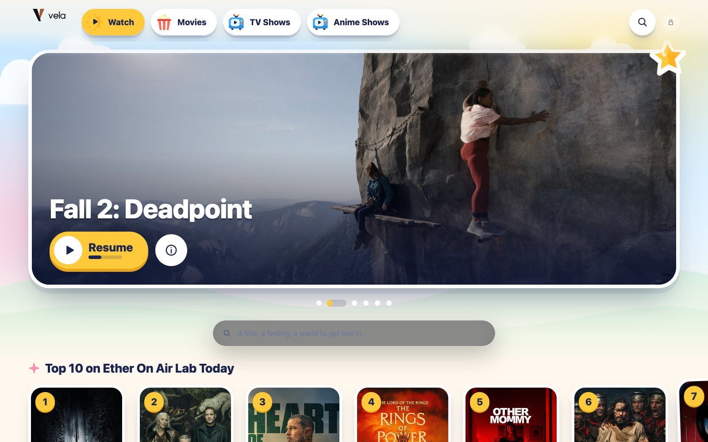<p align="center"><sub><b>Kids.</b> Big bright tiles, three simple ways in, and a grown-ups corner</sub></p></td>
  </tr>
  <tr>
    <td width="50%" valign="top">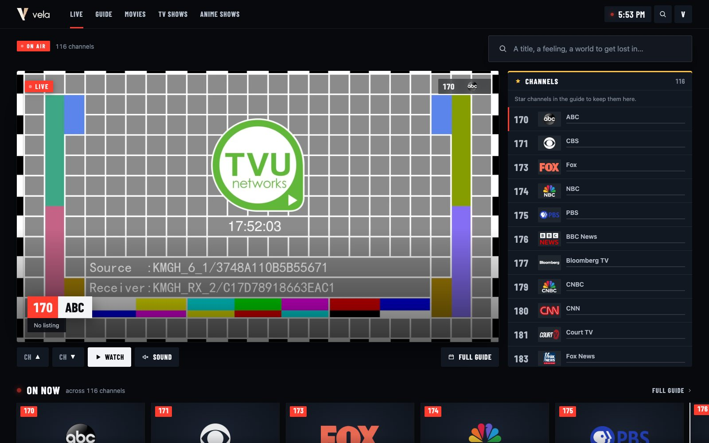<p align="center"><sub><b>Broadcast.</b> Live TV first: on now, your channels and the guide, films below</sub></p></td>
    <td width="50%" valign="top" align="center"><br /><br /><b>Make your own.</b><br /><sub>A skin is a JSON document plus assets. Start from <a href="packages/protocol/fixtures/skins">the nine built-ins</a> and read <a href="docs/skin-authoring.md">authoring skins</a>.</sub></td>
  </tr>
</table>

* **Documents, not plugins.** A skin binds a fixed vocabulary of app data to layout and style, and asks the app to act through a fixed set of actions. It **can't run code, make requests or see credentials**, so a skin from anywhere is safe to try.
* **Native everywhere.** One React renderer draws every skin on the web, Apple TV, phones and Android TV. A portability checker flags any style that would draw differently on native before it ships.
* **Versioned and immutable.** Published skin URLs never change, and every release inventory covers the skins it ships, so an update can't break the look you chose.

---

## Search, discovery and the rest of the app

* **A home that knows you.** Ether's personalised rows, up to six hero titles each with a reason (resume, next episode, picked for you), a ranked Top 10, and Continue Watching that follows you across apps.
* **Search by feeling.** Names match on every keystroke. Describe a mood (*"cute cozy rainy day"*) and Ether's descriptive search answers once you pause, shown once it's final instead of reshuffling under you, in the same multi-row grid as your library.
* **Title pages worth opening.** Extras and trailers, cast and crew with portraits, ratings from Rotten Tomatoes, IMDb, Metacritic, TMDB and Letterboxd, and the technical chips that matter: resolution, HDR transfer or Dolby Vision profile, audio codec and channels.
* **Installs like an app.** A digest-verified service worker, an offline page, and update handling that never strands an open tab.

<table>
  <tr>
    <td width="33%" valign="top"><a href=".github/assets/search.jpg">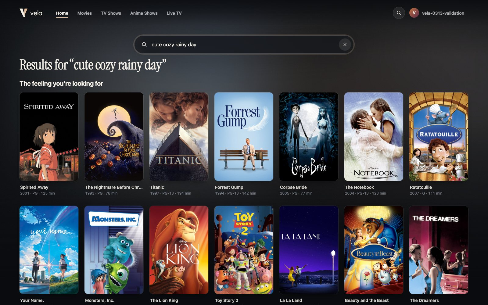</a><p align="center"><sub><b>Search by feeling</b></sub></p></td>
    <td width="33%" valign="top"><a href=".github/assets/detail.jpg">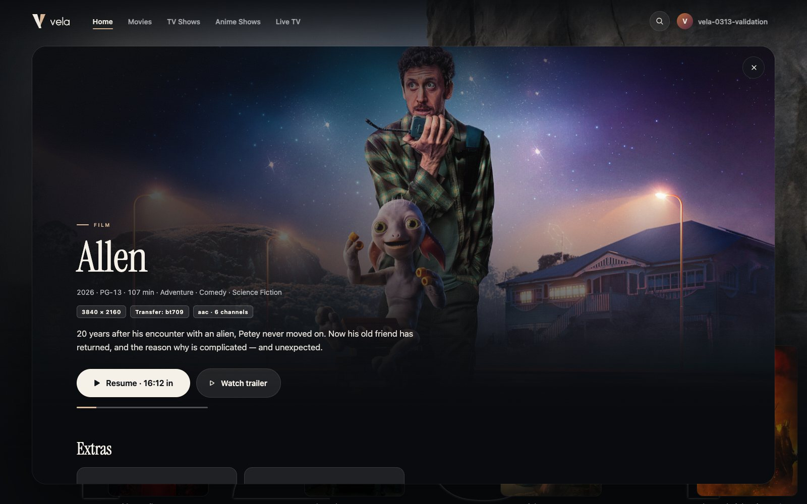</a><p align="center"><sub><b>Title pages</b> with the technical facts</sub></p></td>
    <td width="33%" valign="top"><a href=".github/assets/library.jpg">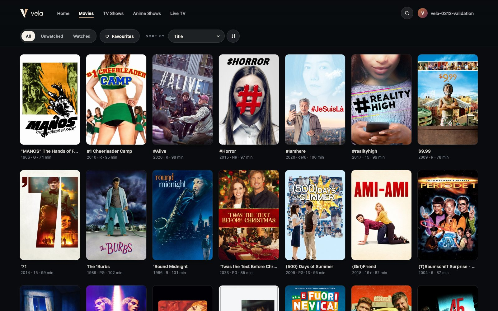</a><p align="center"><sub><b>Libraries</b> with filters and sort</sub></p></td>
  </tr>
</table>

---

## The Ether protocol

Vela speaks Jellyfin, Emby and Plex, but it was designed around **Vela protocol v0**, the API [Ether](https://github.com/braedonsaunders/ether) serves at `/vela/v0`. Most media APIs were built for a server that transcodes everything. This one was built for a client that might not need to. ([Reference](packages/protocol/README.md) · [wire types](packages/protocol/types.ts))

* **Playback plans, not stream URLs.** The server answers Play with a plan: ranked `direct`, `remux` and `transcode` paths over `file` or `hls`, each with its own readiness (`ready`, `preparing`, `on-demand`). Switching between paths requires proof that they share a timeline, so a fallback lands on the same frame with the same audio.
* **Original-file negotiation.** The client declares exactly which demuxers and decoders it has, whether it supports byte ranges and whether it has WebGPU. The server returns the probed facts of the original. Capabilities are never mistaken for proof that something decodes.
* **Generations against races.** Source and seek generations make a stale seek or track switch fail with `409 stale_generation` instead of silently winning. Observations carry increasing sequence numbers.
* **Safe to retry, cheap to refresh.** Every `POST` carries an idempotency key kept for 24 hours, cacheable reads use ETags and `304`, and continuation cursors are bound to the viewer, policy and snapshot.
* **Honest by design.** Readiness is reported separately from publication, and a missing field means *unknown*, never *false*. Prefetching doesn't count as an impression, and interaction receipts (`visible`, `selected`, `played`) feed personalisation only with what a viewer actually did.
* **Everything else a modern client needs:** device grants, quick connect and single-use origin-bound web codes, live session events over SSE with replay, trickplay sprites, trailer-preview grants, theme music, the audio-only fallback, and a live latency policy.

---

## Bring your own server

| Server | Browse & search | Playback | Progress | Live TV | Sign-in |
| :--- | :--- | :--- | :--- | :--- | :--- |
| **Ether** | Everything, including personalised home and search by feeling | Original direct, remux, transcode and audio-only fallback | Yes | Full guide | Password, quick connect, device codes |
| **Jellyfin / Emby** | Libraries, collections, detail, search | Direct or HLS via PlaybackInfo | Reported to the server | Yes, without live seeking | Password or Quick Connect |
| **Plex** | Libraries, detail, search | Direct or universal transcode | Timeline reports | DVR channels | plex.tv PIN at `plex.tv/link`, preferring HTTPS, non-relay connections |

Add servers from **Profile › Add a server** and switch between them in one tap. Vela detects what's on the other end, and credentials stay in platform storage. Skins never see them.

---

## Under the hood

```
       Web / PWA          Apple TV · iPhone · iPad          Android · Android TV          Windows
           │                         │                               │                          │
  ┌────────┴─────────────────────────┴─────────── VELA ──────────────┴──────────────────────────┴────────┐
  │  Skins               9 built-in documents · one React renderer · portability checker                 │
  │  App                 Expo Router screens · home · title · library · search · Live TV · player chrome │
  │  Core                Sessions · Ether / Jellyfin / Emby / Plex adapters · search lanes · live guide  │
  │  Player contract     One view API for every platform                                                │
  │  Web engine          Range source · MKV/MP4 demux · WebCodecs + WASM video · WebGPU render + HDR    │
  │                      WASM TrueHD/DTS/E-AC-3 + 46-codec FFmpeg audio · libass · PGS · MSE HLS + ABR  │
  │  Native engines      AetherEngine (Apple) · Media3 ExoPlayer (Android) · libmpv (Windows, Linux)    │
  └──────────────────────────────────────────────┬──────────────────────────────────────────────────────┘
                                                 │  Vela protocol v0 · Jellyfin · Emby · Plex
                                                 ▼
                                   Ether  ·  Jellyfin  ·  Emby  ·  Plex
```

| Path | What lives there |
| :--- | :--- |
| `apps/vela` | Expo routes, screens, platform storage and app assets |
| `apps/vela-windows` | The Windows host: WebView2, libmpv and the media proxy |
| `packages/core` | Server adapters, sessions, discovery, search and the live guide |
| `packages/skin` | Skin resolution, the renderer and widgets |
| `packages/protocol` | Wire types, the skin schema and the built-in skins |
| `modules/vela-player` | The web engine and the native players (AetherEngine, Media3, libmpv) |
| `tools/release` | Web export, signed inventories and distribution tooling |

Releases are signed inventories. Ether installs them atomically, can roll back, and keeps every content-addressed file an open tab might still ask for. See [architecture](docs/architecture.md) and [distribution](docs/distribution.md).

---

## Getting started

**On the desktop (Windows, macOS, Linux).** Download Vela from [the latest release](https://github.com/braedonsaunders/vela/releases/latest), open it, and type your server's address. Vela works on its own with **Ether, Jellyfin, Emby or Plex**; no Ether required. It updates itself from Vela's releases.

| Platform | Download | Playback |
| :--- | :--- | :--- |
| **Windows 10/11** (x64) | `Vela-Setup-<version>-x64.exe`, a signed per-user installer | Native **libmpv** under the Vela player |
| **macOS** (Apple silicon) | `Vela-<version>-mac-arm64.dmg`, signed and notarized | Native **AetherEngine** with EDR HDR |
| **Linux** (x64) | `.AppImage` or `.deb` (glibc 2.35+, Ubuntu 22.04 and later) | Native **libmpv** with VA-API, VDPAU and NVDEC |
| **Android, Android TV** | `Vela-<version>-android.apk` / `-androidtv.apk`, to sideload | **Media3 ExoPlayer** |

**In the browser, with Ether.**

1. Run [Ether](https://github.com/braedonsaunders/ether) and create a viewer account.
2. Open `/vela` on your Ether server in a current Chrome or Edge.
3. Sign in, then add Jellyfin, Emby or Plex servers from **Profile › Add a server** if you have them.

Vela includes no media and no provider accounts. Your servers supply the catalogue and the streams.

## Where it stands

| Platform | Status |
| :--- | :--- |
| **Web / PWA** | Ships with Ether. Signed releases pass Ether's installer qualification (install, upgrade, rollback, reinstall). |
| **Windows** | Standalone app with native mpv playback, an Authenticode-signed installer and self-updates. A new certificate builds SmartScreen reputation over its first downloads. |
| **macOS, Linux** | Standalone apps with native playback (AetherEngine on Mac, libmpv on Linux) and self-updates. macOS builds are Developer ID signed and notarized. |
| **Apple TV, iPhone, iPad** | Feature-complete on AetherEngine and in daily use on a real Apple TV and iPhone; TestFlight and the App Store are next. |
| **Android, Android TV** | Feature-complete on Media3 ExoPlayer; signed APKs to sideload. Real-device testing on Android TV and Google Play are next. |

## Questions you're about to ask

**Does it really never transcode?** It never transcodes when it doesn't have to. Original-file playback needs a secure page and a browser with WebGPU, WebCodecs and AudioWorklet. Today that's qualified for H.264 and HEVC video with 16 audio codecs, including TrueHD and DTS. Anything else takes the server's remux or transcode path automatically, and an audio-only problem costs only an audio transcode.

**Which browsers?** Current Chromium browsers (Chrome, Edge) get original playback. Browsers without WebGPU still play everything, through the server's other paths.

**Is 12,000 channels a real number?** Yes. It's a 12,000-channel test lineup, scrolled and jumped end to end at 60 fps. The listings load in windows, so the size of the lineup doesn't change how much the guide fetches at once.

**Can a skin do something nasty?** No. Skins are data. They can't run code, make network requests or read credentials.

**Can I write my own skin?** Yes. Copy a built-in from [`packages/protocol/fixtures/skins`](packages/protocol/fixtures/skins), read [authoring skins](docs/skin-authoring.md), and check it with the portability checker.

## License

Vela is licensed under [GPL-3.0](LICENSE). Third-party components, including FFmpeg, libmpv, AetherEngine, Media3, libass and the pinned decoder packages, keep their own licenses; see [third-party notices](THIRD_PARTY_NOTICES).
