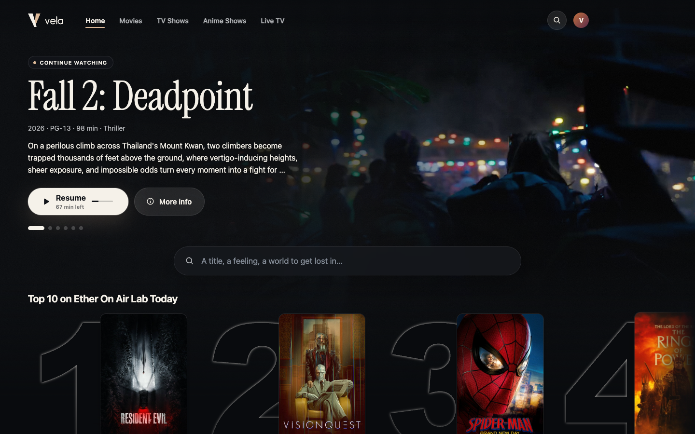
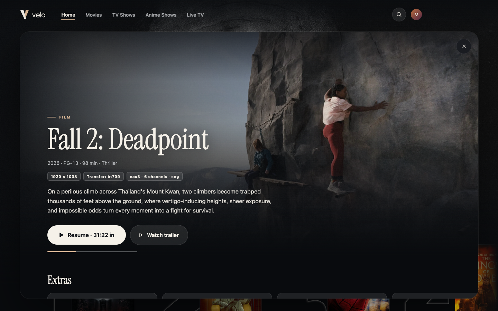
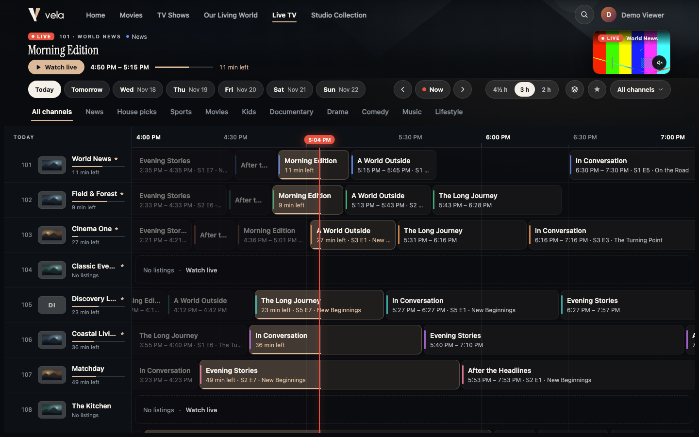

  

<h2 align="center">A cinematic home for the things you love to watch.</h2>

  Browse your Ether catalogue, pick up where you left off, and make the experience your own.

  <a href="#getting-started">Getting started</a> ·
  <a href="#your-viewing-experience">Your experience</a> ·
  <a href="#make-it-yours">Skins</a> ·
  <a href="#where-it-stands">Status</a>

  

## Your viewing experience

Vela brings your movies and shows together in a viewing experience designed for the screen in front of you. Explore your home rows, search for something new, and open a title to see its details and start watching.

  

Your Ether viewer account keeps your progress, so you can return to what you were watching. Playback includes controls for audio and subtitles when available. If your server has Live TV configured, explore its channels and guide in Vela.

  

## Getting started

1. Set up [Ether](https://github.com/braedonsaunders/ether) and a viewer account.
2. Open `/vela` on your Ether server in a browser.
3. Sign in as your viewer and choose something to watch.

Vela does not include media or provider accounts. Your Ether server supplies the catalogue and streams.

## Make it yours

Vela supports skins that change the presentation of the app. Choose a look that fits your screen and taste while keeping your server and viewer account.

## Where it stands

Vela 0.2.6 runs on the web with Ether. TV, iOS and Android apps are in development; native device and installer qualification is still underway. A Windows desktop app with native mpv playback is in development.

Vela is built with React Native and Expo, with shared client packages and platform-specific playback. Ether is the reference server.

## License

Vela is licensed under [GPL-3.0](LICENSE). Third-party components retain their own licenses; see [third-party notices](THIRD_PARTY_NOTICES).
