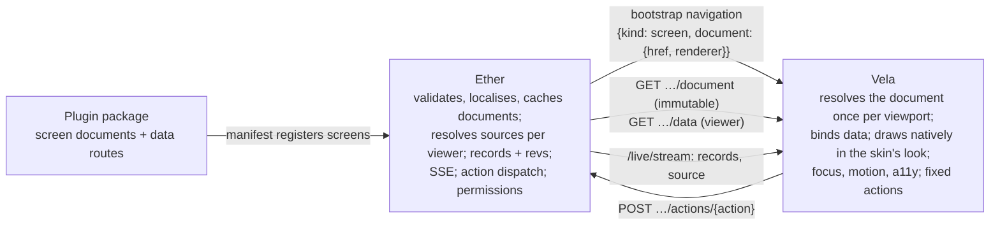

# Plugin screens (design, for approval)

Status: approved by the owner on 2026-11-24, with the decisions recorded under
[Owner decisions](#owner-decisions), including a hard cut and plugin-described player overlays and
surfaces. Being built on `plugin-screens/main`. The Ether side of the same contract is
written by the Ether plugin-screens lead (`plugin-screens/ether-design.md` in the Ether
coordinator's thread storage); the two documents describe one contract and must agree.

## Summary for the owner

A plugin describes a screen as a document. Vela draws that document natively on web, phones,
tablets, TVs and desktop, in the active skin's look. Sports becomes the first such screen,
written by the Sports plugin. Vela no longer carries Sports code. A second plugin (a news desk,
a podcast studio, a games launcher) can ship an equally rich screen without a Vela release.

The proposal in five decisions:

1. **One language.** A plugin screen is written in the skin document language Vela already
   draws: boxes, text, images, icons, repeats and templates, with the same styles, conditions and
   `{…}` holes. A small set of new compiled blocks adds the behaviour skins never needed:
   virtualised shelves, tabs bound to a parameter, fitted tables, a line graph, a streamed section
   list and a muted live preview. Skins can use the new blocks too, and both kinds of document
   share one `RENDERER_VERSION`.
2. **The skin owns the look.** A plugin document may only colour, size and type things with
   the skin's `$ui` tokens, with mixes of those tokens, with colours that arrive as data (a
   team's colour), and with a declared palette of at most 8 colours for ink drawn on those data
   colours. It cannot load fonts or draw outside its slot. Sports therefore looks like
   Sports in Cinematic, Broadcast, Mochi or any other skin, as it does today.
3. **The document is static and the data is live.** The document is immutable and cached by
   hash. Ether resolves the viewer's data into named sources. Anything that changes live (a game,
   a team, a channel) is a shared record with a revision. The existing live stream pushes record
   and source changes, so a goal redraws only the cards that show that game.
4. **Actions come from a fixed list.** The list is: navigate, set a parameter, toggle local
   state, play, add to multiview, open a link (never on TV), go back, and call a plugin action
   through Ether. A plugin never runs code on the client and never makes its own requests.
5. **Old clients degrade by negotiation.** Vela sends its renderer version. Ether serves the
   newest document variant the client can draw, or leaves the screen out of navigation. There is
   no legacy path: when plugin screens ship, Sports exists only as plugin documents, and builds
   that predate them show no Sports screen (the owner's hard cut).
6. **Surfaces beyond screens.** The same documents fill other host slots: player overlays (the
   score bug, the ticker), alert toasts, a Home row and a title-page panel. They are bound to
   what the host is showing and bounded in size, placement and focus. See
   [Surfaces](#surfaces-player-overlays-alerts-home-rows).

Migration in four phases: renderer support behind a flag, Sports re-expressed with checked pixel
parity on web, phone and TV, removal of the hard-coded Sports code, then opening the system to
third-party plugins. Estimated effort on the Vela side is 37 to 50 worker-days including surfaces, built by five workers in parallel. The main
risks are TV performance, fine pixel parity, and keeping the shared schema in step with Ether.
See [Migration](#migration-plan), [Effort](#effort) and [Risks](#risks). The decisions the owner
needs to make are listed under [Owner decisions](#owner-decisions).

## What exists today

| Piece | Where | Generic or Sports-specific |
| --- | --- | --- |
| Skin documents: node tree, styles, conditions, templates, motion, renderer versioning | `packages/protocol/skin.ts`, `packages/skin/src/resolve*`, `render.tsx` | Generic; data comes only from the app's fixed vocabulary (`vocabulary.ts`) |
| Navigation entries `{kind: 'screen'}` after Live TV | `packages/protocol/live-events.ts`, `apps/vela/src/plugin-screens.ts` | Generic |
| `Screen` = typed sections (`hero`, `events`, `schedule`, `table`, `leagues`, `entities`) | `packages/protocol/live-events.ts` | Sports-shaped: every section type is a live-event concept |
| Section route `screen/[id]` mounts `SportsScreen` | `apps/vela/app/(sections)/screen/[id].tsx` | Hard-coded |
| Game page `game/[id]` mounts `GamePage` (framed modal on wide screens, full screen on TV and phone) | `apps/vela/app/game/[id].tsx` | Hard-coded |
| Sports drawing: hero, mini and event cards, tables, team chips, probability graph, plays, reveal | `packages/skin/src/widgets/sports/*` (about 2,000 lines) | Hard-coded; follows the skin through `SportsLook`, which is derived from `ui` |
| Derived facts: phase, sides, winner, status text, watch targets, airing, league label | `widgets/sports/model.ts`, `core/src/live/events.ts` | Client logic that the server should own |
| Live store: events merged by `updatedAt`, one SSE for every mounted view's interest | `core/src/store/live-events.ts`, `core/src/live/events.ts` | Generic in shape, typed to `LiveEvent` |
| Player score bug, ticker, alerts | `packages/skin/src/widgets/live-overlay/*` | Sports-specific overlays (later phase, see [What stays built in](#what-stays-built-in)) |
| Multiview, guide, music | native routes and widgets | Built in, and they stay built in |

What carries over: the skin renderer already draws whole pages (home, title, live home) from
data, with TV focus, hover, press, motion, accessibility, viewport variants and budgets. What is
missing: data that comes from a server rather than from the app's vocabulary, actions with
structured arguments, live records, virtualisation, and a few visual blocks (graph, fitted
table).

## Goals and non-goals

Goals:

- A plugin can describe screens and pages composed from Vela's building blocks, bound to data
  Ether resolves for the viewer, live over the existing stream.
- Native on every platform, including TV focus, the remote's Back and Menu, reduced motion,
  screen readers and safe areas, with no per-platform document.
- The screen follows the active skin.
- Sports reaches pixel parity with today's screens on web, phone and TV, and its hard-coded code
  is then deleted.
- Old clients and old servers degrade without breaking.

Non-goals for version 1:

- Code in documents. There are no expressions beyond the fixed pipes listed below, no scripts,
  and no client-side requests made by a document.
- Plugin-supplied fonts, raw CSS colours or drawing over Vela's shell.
- Replacing built-in surfaces: music, Live TV guide, player, multiview, title pages.
- Skins restyling a particular plugin's screen. A later extension could allow a skin to override
  named templates.

## The three parties



Who owns which part of the contract:

| Part | Owner | Notes |
| --- | --- | --- |
| Node tree, blocks, styles, bindings, pipes, conditions, actions, focus, responsive rules, renderer versions | Vela (`packages/protocol/screen.ts`) | Ether validates documents structurally against a JSON Schema generated from these types (`schemas/plugin-screen.v1.json` in Ether) |
| `params` (per page), `sources` (types and arguments), served `deps` and `actions`, `strings` localisation, record keys and revisions, view models (Ether section 5.4), endpoints, caching, SSE topics, action dispatch, permissions, image and link envelopes, old-client compatibility | Ether | Ether derives each source's parameter dependencies from its `{param.x}` holes and serves them as `deps` |
| The Sports documents and their data routes | The Sports plugin | Ether core ships no screen documents. The live-events hub stays generic core and reaches documents through built-in source types |

## Endpoints (Ether design sections 6 and 7, summarised)

- Bootstrap `navigation` entries:
  `{ kind: "screen", id, title, icon, page: "index", document: { href, renderer } }`. First paint
  needs one bootstrap round trip plus one data read.
- `GET /vela/v0/screens/{id}/pages/{page}/document?v=<hash>&r=<variant>&l=<locale>` returns the
  compiled, localised document with `deps` on each source. It is immutable and carries an ETag.
  A stale `v` answers 301 with the fresh `href`.
- `GET /vela/v0/screens/{id}/pages/{page}/data?sources=a,b&p.<param>=…&tz=<IANA>` returns
  `{ rev, sources, records, errors?, live: { topic } }`. Page parameters carry a `p.` prefix.
  Omitting `sources` reads every source that is not lazy. A screen the viewer may not see answers
  404.
- `GET /vela/v0/live/stream?topic=<topic>&since=<rev>&tz=<IANA>`. The topic is opaque and sealed
  by Ether, and Vela never rebuilds the query. On connect, Ether replays every record and source
  with a revision above `since`, which closes the race between the data read and the stream.
  After that the stream sends `records` (`{ records: { key: { rev, value } } }`) and `source`
  (`{ screen, page, source, rev, value }`). `update`, `alert` and `heartbeat` are unchanged. A
  viewer holds at most 4 page topics, and a fifth closes the oldest.
- `POST /vela/v0/screens/{id}/actions/{action}` with `{page, params, args}` and an idempotency key
  returns `{ records?, sources?, refresh?, toast?, navigate? }`.
- Vela sends `X-Vela-Screen-Renderer: <RENDERER_VERSION>` on bootstrap and on every screen call.

## The screen document

New file `packages/protocol/screen.ts`. The node types are those of `skin.ts`, extended as
described below.

```ts
export interface ScreenDocument {
  schema: 1;
  kind: 'screen';
  /** The lowest RENDERER_VERSION that draws this document (19 or more). */
  renderer: number;
  /** Blocks and kit templates the page cannot do without, by name (`lineGraph`, `vela:switch`).
   *  A client missing one shows "update the app" instead of the page. */
  requires?: string[];
  /** Plugin-scoped screen id and the page within it ("index" is the section page). */
  screen: string; page: string; version: string;
  title: Template;
  /** section: a top-level section inside the active shell. page: opened over the page it came from:
   *  a framed modal on web, desktop and tablets, the whole screen on TV and phone (today's game page). */
  presentation: 'section' | 'page' | 'playerOverlay' | 'toast' | 'homeRow' | 'titlePanel';
  /** Ether's: typed page parameters ({param.league}); the URL carries them. */
  params?: Record<string, ParamSpec>;
  /** Ether's: named data, resolved per viewer; served with `deps` (the params each one reads). */
  sources: Record<string, SourceSpec>;
  /** Served by Ether from the manifest: the plugin actions this page may call, with any confirmation text. */
  actions?: Record<string, { confirm?: string }>;
  /** Already localised by Ether: one locale's strings, read as {s:key}. A string may hold holes.
   *  (In the plugin package the file holds every locale; Ether serves one.) */
  strings?: Record<string, string>;
  /** $name in style values: only $ui.* values, numbers, and min/max/color-mix over them. */
  tokens?: Record<string, string>;
  /** At most 8 literal colours, read as $palette.<name>, for ink drawn on data colours (text on a
   *  team-coloured hero), where the skin's ink cannot apply. Listed in the install report. */
  palette?: Record<string, string>;
  templates?: Record<string, Node>;
  motion?: Record<string, MotionPreset>;
  /** As in skins (opacity, translate, scale, rotate), plus `color` to a `$ui` token (renderer 19). */
  keyframes?: Record<string, Record<string, { opacity?: number; translate?: string; scale?: number; rotate?: number; color?: string }>>;
  /** The page. */
  tree: Node;
  /** Drawn while the first data read is pending; a generic skeleton when absent. */
  loading?: Node;
  /** Drawn when the first read fails (env.canRetry, the retry action); a generic one when absent. */
  failure?: Node;
  /** Re-read the non-lazy sources this often while shown, beside the stream (seconds, >= 60). */
  refresh?: number;
  /** The element id focused first on TV and keyboard (else the first focusable). */
  focus?: { initial?: Template };
}
```

### Node language changes (renderer 19, shared with skins)

These are additions to `skin.ts`. Older skin documents are unaffected.

| Change | Why |
| --- | --- |
| `repeat`: `as` (alias), `skip` (offset), `exclude` (a record key left out before `limit` applies), `key` (an identity template such as `{t.key}`) | Bind items by name (`{game.sides.0.score}`), start at an offset, leave out the hero from the companion cards beside it, and keep identity when the order changes |
| `tv?: Style` beside `small` and `wide` | TV is a class of its own (Sports widens cards and adds focus stops on TV) |
| `press: { action, arg?, args?: Record<string, Template>, optimistic? }` | Structured action arguments and optimistic patches |
| `use: { template, with?: Record<string, Template>, children? }`: `with` is read as `{arg.<name>}` inside the template, and `children` draw where the template has a `children` slot | Parameterised kit templates (pill, chip, crest), and panels that wrap content |
| `image.fallback?: Node` | A crest without a logo, or whose logo fails, draws its initials |
| `onChange?: { value: Template; motion: string }` | Play a preset when a bound value changes. A score pops to 1.16 in the accent colour and settles, as `Score` does today. |
| Document keyframes may animate `color` to a `$ui` token | The score pop's colour |
| Any style value may hold a hole in a screen document. The value is validated after it is filled: lengths, percentages and colours only | Width from data (the probability meter), team colours in gradients |
| Token arithmetic resolved once: `min()`, `max()`, `color-mix()` over `$ui` values and numbers | Sports' `card`, `hairline` and clamped radii are mixes of `ui` today (`look.ts`) |

### Bindings

A screen document uses the same `{…}` holes skins use, extended with data paths. There is no
binding object.

| Hole | Reads |
| --- | --- |
| `{src.<source>.<path>}` | A source. Paths are dot segments with numeric indices (`events.0.sides.1.score`). `length` gives the length of a list. A `{"$record": key}` met along the path is followed into the shared record pool. |
| `{<alias>.<path>}` | The item a `repeat`, `shelf`, `grid` or `tabs` is drawing (`as`). `{$index}` gives its position. |
| `{src.<source>.$pending}` | `true` while a re-read of that source is in flight (its previous data stays drawn) |
| `{src.<source>.$error}` | The source's error code when Ether answered `errors[id]` (a timeout, say). The rest of the page draws, and `retry` with `source` re-reads it. |
| `{<alias>.$key}` | The record key of the item being drawn (`event:…`, `entity:…`), for actions that take a `ref` |
| `{param.<name>}` | The page's parameters. These change at once when chosen, before the dependent sources answer. |
| `{state.<name>}` | Local flags (`toggle`, `only`, `open`, `close`), as in skins |
| `{env.small}`, `{env.wide}`, `{env.tv}`, `{env.still}`, `{env.canMultiview}`, `{env.canPlay}` | The viewport class and app capabilities. A deliberately short list. |
| `{s:<key>}` | The document's strings (already localised). A string may itself hold holes. |
| `{arg.<name>}` | Inside a `use` template: its `with` values |

A node may name lazy sources in `needs`. They are read when the node is about to draw (the
`sections` block draws children progressively), so a page's first read stays small.

Pipes are a fixed list with no general expressions. The client keeps only what depends on the
viewer's clock, locale or skin:

| Pipe | Result |
| --- | --- |
| `start` | Today's `startText`: `7:30 PM`, `Tomorrow 7:00 PM`, `Sat 7:00 PM`, `Nov 30 7:00 PM` (local time zone and locale) |
| `day` | A date's chip label: `Today`, `Tomorrow`, `Yesterday`, `Thu 26` |
| `time`, `date`, `duration` | Locale formats |
| `number`, `percent` | Locale numbers; `percent` maps 0..1 to `0..100` |
| `upper`, `initials` | Text |
| `not`, `count`, `eq:<v>`, `lt:<n>`, `first` | Flip a boolean; a list's length; comparisons that give `true` or `false` (`first` is `$index` = 0) |
| `then:<a>,<b>` | `a` when the value is truthy, else `b` (string keys allowed: `then:s:saved,s:save`) |
| `with:<name>=<path>,…` | After `{s:key}`: fills that string's `{arg.*}` holes from data |
| `tint` | A side's colour dark enough for white text (`color`, else `altColor`, else `#1d2a44`) |
| `readable` | A data colour made legible on the skin's page colour (the graph and legend today) |
| `crest` | A side's colour, or a hue hashed from its name so that crests still differ |
| `alpha:<0..1>` | Any colour at that opacity |
| `\| · ` (literal text after `\|`) | Prefix a separator only when the value is non-empty: `{venue\| · }` |

A missing path reads `''`, as an absent vocabulary key does in a skin. A hole never throws.

Conditions are the skin `Condition` type over the same keys, for example
`{ "test": "game.phase", "is": "eq", "value": "live" }`.

### Building blocks

Most of a screen is ordinary nodes. The kit and the blocks below provide what nodes alone cannot.

**Kit templates** are built in. The renderer supplies them in the active skin's look, so a plugin
does not need to hand-roll controls. Each one reads `with` arguments:

| Template | Draws | Today's equivalent |
| --- | --- | --- |
| `vela:pill` (`label`, `glyph`, `primary`) | The action button: ink fill (primary) or translucent, accent on focus, lift | `Pill` |
| `vela:chip` (`label`, `on`, `count`) | A choice chip (days, leagues) | `Chip` |
| `vela:tab` (`label`, `on`) | The library tabs' pill. `tabs` draws its options with it. | `ToolbarButton` |
| `vela:heading` (`text`, `aside`) | A section heading | `Heading` |
| `vela:panel` | A card surface with a hairline; focusable on TV when `focusable` is set | `Panel` |
| `vela:crest` (`logo`, `abbr`, `color`, `size`, `ring`) | A logo in a disc, falling back to initials on the colour | `Crest` |
| `vela:liveBadge` (`small`) | The LIVE badge with its pulsing dot | `LiveBadge` |
| `vela:switch` (`on`, `label`, `glyph`) | A labelled switch | `ScoresSwitch` |
| `vela:placeholder` (`width`, `height`, `radius`) | A skeleton bar | `Placeholder` |
| `vela:failure` | The unavailable message with Retry | `Failure` |

**Blocks** are new node types, compiled widgets with behaviour:

| Block | Purpose | Key fields | TV focus |
| --- | --- | --- | --- |
| `sections` | The page's vertical list. Each child is drawn inside its own error boundary (one that cannot draw is logged and left out). The first three children draw with the first frame and the rest follow one per frame. The page title is given as a hidden level-1 heading. | `children`, `gap` | Vertical; focus memory per child |
| `shelf` | A horizontal, virtualised list of an item template | `over`, `as`, `key`, `item`, `itemWidth` (per class; `fit a..b` sizes an item to its content within bounds), `gap`, `stableOrder` (keep the first-seen order while mounted), `empty` | One focus row; remembers its position |
| `grid` | A wrapping grid of an item template, virtualised by row | `over`, `as`, `item`, `columns` (per class), `gap` | Grid movement |
| `tabs` | A chip row bound to a parameter or a state flag, with an optional "all" option | `over`, `as`, `value`, `label`, `count`, `bind: { param \| state, clear? }`, `default`, `all`, `chip` (the kit template to draw each option with; `vela:tab` by default) | One row; a tablist on the web |
| `table` | A fitted table: column widths measured, numeric columns right-aligned, and the rows with `highlight: true` lit | `data` (`{title, columns, rows}`), `compact`, `focusRows` (step rows on TV when longer than N) | Whole-panel or per-row |
| `lineGraph` | A smooth series with an area fill, an end dot, edge labels and a draw-on motion | `series`, `sides` and `subject` (labels and readable colours from the two sides), `live`, `height` | None |
| `player` | One muted live preview of a channel (the live home's tile). At most one per page. Pressing it tunes in. | `channel` | Focusable |
| `paramInput` | A text field bound to a string parameter, debounced. It is never a password field. | `param`, `placeholder` | Focusable |
| `titleCard` | Vela's own card for an `item:` record, drawn by the skin's `card` slot so that it matches libraries | `item` | As a card |

Everything else in today's Sports drawing comes from nodes and the kit: the hero card, event
cards, mini cards, the probability meter, plays and the reveal panel. The worked examples below
show this.

## Data, records and live updates (client)

The store gains a `screens` slice beside `liveEvents`:

- `documents[href]` holds each document, fetched once (it is immutable) and resolved once per
  viewport and locale, exactly like skins.
- `pages[screen/page?params]` holds `{ sources, pending, failed, rev, topic }`. A parameter
  change re-reads only the sources whose `deps` include that parameter. While they load, the old
  data stays drawn and `$pending` is true. Today the schedule dims and shows placeholders in this
  state, and the document can still do that.
- `records[key]` is one pool shared by every page and overlay, holding `{rev, value}`. A newer
  revision wins. Each hole that reads a record subscribes to that record alone, so a pushed goal
  re-renders the cards that show the game and nothing else. Today's `liveEvents.events` merge
  becomes this pool: `event:` records are the same live events that the score bug, ticker and
  alerts read.
- The stream manager (`core/src/live/events.ts`, `streamQuery`) adds page topics to the
  interests it already merges, with `since` set to the page's `rev` and the viewer's `tz`. There
  is still one SSE connection for every view's interest. Ether allows at most 4 page topics per
  viewer, so only the section on show and an open page follow.
- Records are released when no page references them and no view follows them.
- A section on show follows its topic, as `SportsScreen` follows `screens` today. A hidden
  section stops following and re-reads when shown again.

## Actions

`press.action` gains these entries. Arguments are templates that are filled and then validated
before anything happens.

| Action | Arguments | Effect |
| --- | --- | --- |
| `navigate` | `page`, `screen?` (defaults to this screen), any `params` | Opens a page of a plugin screen, presented as that page declares. Built-in targets are a fixed list: `title` (an `item:`), `live`, `guide`, `search`, `home`, `library` (an id). |
| `setParam` | `name`, `value` | Changes a page parameter and re-reads the dependent sources. The URL updates (web history replaces). |
| `toggle` / `only` / `open` / `close` | flag | Local state, as in skins |
| `play` | `channel` or `programme` + `channel` + `from: start` or `item` | The app's own playback routes (today's `watch` and `watchFromStart`) |
| `multiview` | `channel` | Adds the channel as a multiview tile. The action exists only while multiview is available (`env.canMultiview`). |
| `plugin` | `name` (an action the plugin manifest declares, or Ether's own: `ether.favorite {ref, on}`, `ether.reveal {event}`, `ether.spoilerFree {on}`), `args`, optional `optimistic: { record \| source, path, value }` | POST to Ether with `{page, params, args}` and an idempotency key. The answer's `records` and `sources` patch the store, `refresh` re-reads the named sources (Ether has already resolved them), `toast` shows a line of at most 200 characters, and `navigate` is a `navigate` action (`#/$defs/NavigateAction` in the generated schema). The optimistic patch is client-only and is dropped when the answer lands or fails. The pressed control is busy until then. When the manifest gives the action a `confirm` text (served in `actions`), Vela asks first. |
| `openLink` | `href` | Only an `href` that reached this page inside an Ether `$link` envelope (`{href, host}`). A literal URL in a document is refused. The link opens outside the app, after the platform's confirmation. Never on TV: the node is hidden there. |
| `back` | | Closes a page, or follows the section's ordinary Back |
| `retry` | | Re-reads what failed |

## TV focus

Focus follows the skin renderer's existing rules. Boxes with `press` are focusable. On TV a
`readingStop` box takes focus so the remote can reach text. Blocks add their own rules:

- `sections` is a vertical focus column. Moving down enters the next child that has a focusable
  element, scrolling it into view. Each child remembers its last focused element.
- `shelf`, `tabs` and a `tabs`-like row of pills are horizontal focus rows that remember their
  position. Up and down leave the row towards the nearest focusable element in that direction.
- `vela:panel` with `focusable` on TV takes focus as a whole, so the remote can scroll to a
  passage with no controls (a short table, the probability graph). A `table` longer than
  `focusRows` rows steps row by row, so the score never scrolls off the top.
- `focus.initial` names the first element (the game page's first Watch button). Otherwise the
  first focusable element in document order is used.
- Back and Menu: a `page` closes, and a `section` goes back to navigation as every section does
  today. Escape on the web does the same.

## Responsive rules

The classes are those skins use: `small` (under 640 px), the default, `wide` (1200 px and up),
and `tv`. Each node may carry a style variant per class. Breakpoints (`below`, `above`) are
evaluated against the slot's width. Lengths are CSS pixels that the renderer scales per platform,
which today means a quarter larger on TV and Android TV's pixel scale. This is the same `px` that
`SportsLook` uses. Block fields that vary by class take
`{ "default": …, "small": …, "wide": …, "tv": … }`.

## Theming

- Colours: `$ui.*` tokens (`page`, `raised`, `ink`, `inkSecondary`, `inkQuiet`, `inkInverse`,
  `accent`, `onAccent`, `control`, `controlHover`, `glass*`, `focusHalo`, `live`, `alert`, …),
  `color-mix()` over them, `transparent`, and data colours that go through a colour pipe. The
  `ui` block gains two content colours that Sports uses today: `highlight` (Sports' gold,
  `#f5c451`) and `positive`. Skins without them take the defaults.
- Type: the skin's two stacks (`$ui.font`, `$ui.fontDisplay`). Sizes and weights are free.
- Radii: `$ui.radiusControl`, `$ui.radiusCard`, `$ui.radiusPanel`, optionally clamped with `min()`.
- Focus: the skin's ring and halo, plus the document's own `focus` styles drawn in tokens.
- Literal colours: white and black at any opacity (ink on data-coloured grounds), and the
  document's `palette` (at most 8 entries, for the same purpose). Any other literal colour fails
  validation. On the client it reads as `transparent` and logs a warning. Sports' palette is two
  colours: the light pink status line on the hero (`#ffd7dc`) and the shade at the top of the
  game page's band.

## Versioning and capabilities

- There is one renderer version. Plugin screens arrive as `RENDERER_VERSION` 19. A document
  declares the lowest version it needs, as skins do. `X-Vela-Screen-Renderer` carries the
  client's version. Ether's design calls this number `SCREEN_RENDERER` and leaves it to Vela.
  It is the skin renderer's version, because both kinds of document are drawn by the same code
  and a node feature added for one is available to the other. The first value is 19, not the 3
  in Ether's examples.
- `requires` lists block and kit names. These read better in an install error than a capability
  hash. Ether checks that the names exist at the document's `renderer`.
- A plugin may ship several variants of a page with different minimum versions. Ether serves the
  highest variant at or below the client's version. If none fits, the screen is left out of
  navigation for that client.
- A document needing a higher version than the client draws is refused whole, never half-drawn
  (the same rule skins follow, and the `renderer-bump` test fixture rule). An unknown block or
  kit template inside an accepted document draws its `fallback` node, or nothing, inside its
  boundary.
- Hard cut (owner decision): there is no legacy window. Ether deletes `sections`, `GET /screens/:id`
  and the screens-only live routes in the same release that ships plugin screens. Vela deletes the
  hard-coded Sports, the score bug, the ticker and the alerts code in the same release. Builds
  that predate plugin screens show no Sports screen.
- A schema change is additive within a renderer version. Anything else bumps the version.
  Ether's `plugin-screen.v1.json` is generated from `packages/protocol/screen.ts` by a tool in
  this repository (`tools/screen-schema.ts`, phase 0), and its digest is recorded beside
  `RENDERER_VERSION`, so drift fails a check on both sides.

## Security and limits

- Nothing executes. There are no expressions beyond the fixed pipes, and holes read data only.
- A document cannot make requests. Data comes only through Ether's sources, and actions go only
  to Ether.
- Images: `$image` values, which Ether rewrites to signed same-origin proxy URLs, and the
  document's own same-origin `/vela/v0/` assets. Any other URL draws the fallback.
- Links: `https:` only, opened outside the app, never on TV.
- Screen content is clipped to its slot. It cannot draw over the shell, the navigation or the
  player. It has no secure text input and no access to credentials, tokens or other plugins'
  records (Ether namespaces records `p:<type>:<id>` per plugin).
- Limits are enforced by Ether on validation and again on the client:

  | Item | Limit |
  | --- | --- |
  | Document size | 256 KB |
  | Nodes | 4,000 |
  | Depth | 32 |
  | String | 4 KB |
  | Array | 500 items drawn |
  | One source | 256 KB |
  | One data response | 1 MB |
  | Records per plugin answer | 500 |

  The skin budgets (`resolve/budget.ts`) apply per page: node counts, nodes per repeated item,
  images per item, and endless animations or blurs per item. They are checked by
  `tools/skin.ts check` for fixtures and by Ether's validator for plugin documents.
- Plugin action names are declared in the plugin manifest, with typed arguments (at most 8, a
  string at most 512 characters, 8 KB in all). Ether rejects anything else, rate-limits per
  viewer, and re-checks `ref` arguments against the viewer's visibility.

## Worked example: Sports

These are the Sports plugin's two documents, written to reproduce today's screens. They are
abridged only where a template repeats an earlier one. Token names follow `SportsLook`.

### Index page (`sports/index`)

```json
{
  "schema": 1, "kind": "screen", "renderer": 19,
  "screen": "sports", "page": "index", "version": "2.0.0",
  "title": "{s:title}", "presentation": "section", "refresh": 300,
  "params": {
    "league": { "type": "string", "max": 64 },
    "date": { "type": "date" },
    "teamsLeague": { "type": "string", "max": 64 }
  },
  "sources": {
    "viewer": { "from": "viewer" },
    "leagues": { "from": "liveLeagues", "feed": "sports" },
    "hero": { "from": "liveEvents", "feed": "sports", "query": { "league": "{param.league}", "window": "today" }, "sort": "featured", "limit": 1 },
    "also": { "from": "liveEvents", "feed": "sports", "query": { "league": "{param.league}", "state": ["in", "pre", "delayed"] }, "sort": "featured", "limit": 4 },
    "yours": { "from": "liveEvents", "feed": "sports", "query": { "favorites": true, "window": "week", "league": "{param.league}" }, "sort": "start" },
    "live": { "from": "liveEvents", "feed": "sports", "query": { "state": ["in"], "league": "{param.league}" }, "sort": "featured" },
    "schedule": { "from": "liveSchedule", "feed": "sports", "league": "{param.league}", "date": "{param.date}" },
    "standings": { "from": "liveTables", "feed": "sports", "league": "{param.league}", "lazy": true },
    "teams": { "from": "liveEntities", "feed": "sports", "kind": "team", "league": "{param.teamsLeague}", "prefer": "{param.league}", "lazy": true }
  },
  "strings": {
    "title": "Sports", "all": "All", "live": "LIVE", "yourTeam": "Your team", "closeGame": "Close game",
    "yourTeams": "Your teams", "liveNow": "Live now", "schedule": "Schedule", "pickTeams": "Pick your teams",
    "standingsOf": "{src.standings.league.name} standings", "hideScores": "Hide scores",
    "noFavourites": "Follow a team below to see its games here.", "noFavouriteGames": "No games for your teams this week.",
    "noGames": "No games on this day.", "watchOn": "Watch on {arg.name}{arg.number| · }", "fromStart": "Watch from start",
    "addToMultiview": "Add to multiview", "gameDetails": "Game details", "recap": "Box score and plays",
    "onBroadcast": "On {arg.name}", "spoilersHidden": "Scores hidden", "winProbability": "Win probability · {arg.abbr} {arg.share}%",
    "at": "{arg.away} at {arg.home}", "favouriteFailed": "Couldn't save your teams. Try again."
  },
  "tokens": {
    "card": "color-mix(in srgb, $ui.page 8%, $ui.raised 92%)",
    "hairline": "color-mix(in srgb, $ui.ink 8%, transparent)",
    "radiusCard": "min($ui.radiusCard, 18px)",
    "radiusPanel": "min($ui.radiusPanel * 0.6, 22px)",
    "gutter": "max(28px, 4vw)"
  },
  "palette": { "onTeam": "#ffd7dc" },
  "templates": {
    "target": { "type": "text", "text": "{arg.name}{arg.number| · }" },

    "meta": {
      "type": "box", "style": { "flex-direction": "row", "align-items": "center", "justify-content": "space-between", "gap": "8px", "margin-bottom": "8px" },
      "children": [
        { "type": "box", "style": { "flex-direction": "row", "align-items": "center", "gap": "6px", "flex-shrink": "1" }, "children": [
          { "type": "use", "template": "vela:liveBadge", "with": { "small": "true" }, "when": [{ "test": "e.phase", "is": "eq", "value": "live" }, { "test": "e.spoiler", "not": true }] },
          { "type": "text", "text": "{e.league.label} · {e.detail}", "style": { "font-size": "11.5px", "font-weight": "600", "color": "$ui.inkQuiet", "line-clamp": "1" },
            "when": [{ "test": "e.phase", "is": "ne", "value": "upcoming" }] },
          { "type": "text", "text": "{e.start|start}", "style": { "font-size": "11.5px", "font-weight": "600", "color": "$ui.inkQuiet" },
            "when": [{ "test": "e.phase", "is": "eq", "value": "upcoming" }] }
        ] },
        { "type": "text", "text": "{s:closeGame}", "when": [{ "test": "e.close" }], "style": { "font-size": "11.5px", "font-weight": "700", "color": "$ui.highlight" } },
        { "type": "text", "text": "{e.league.label}", "when": [{ "test": "e.close", "not": true }, { "test": "e.phase", "is": "eq", "value": "upcoming" }],
          "style": { "font-size": "11.5px", "font-weight": "600", "color": "$ui.inkQuiet", "max-width": "50%" } }
      ]
    },

    "sideLine": {
      "type": "box", "style": { "flex-direction": "row", "align-items": "center", "gap": "9px", "padding": "2.5px 0" },
      "children": [
        { "type": "use", "template": "vela:crest", "with": { "logo": "{side.logo}", "abbr": "{side.abbr}", "color": "{side|crest}", "size": "24px" } },
        { "type": "text", "text": "{side.short}", "style": { "flex": "1", "font-size": "14px", "font-weight": "600", "color": "$ui.ink", "line-clamp": "1" },
          "states": [{ "when": [{ "test": "side.winner" }], "style": { "flex": "1", "font-size": "14px", "font-weight": "750", "color": "$ui.ink", "line-clamp": "1" } },
                     { "when": [{ "test": "side.loser" }], "style": { "flex": "1", "font-size": "14px", "font-weight": "600", "color": "$ui.ink", "opacity": "0.62", "line-clamp": "1" } }] },
        { "type": "text", "text": "{side.score}", "when": [{ "test": "e.scored" }], "onChange": { "value": "{side.score}", "motion": "scoreFlash" },
          "style": { "font-size": "16px", "font-weight": "800", "color": "$ui.ink", "font-variant-numeric": "tabular-nums" },
          "states": [{ "when": [{ "test": "side.loser" }], "style": { "font-size": "16px", "font-weight": "800", "color": "$ui.ink", "opacity": "0.62", "font-variant-numeric": "tabular-nums" } }] },
        { "type": "text", "text": "{side.record}", "when": [{ "test": "e.scored", "not": true }, { "test": "e.phase", "is": "eq", "value": "upcoming" }],
          "style": { "font-size": "12.5px", "font-weight": "600", "color": "$ui.inkQuiet", "font-variant-numeric": "tabular-nums" } }
      ]
    },

    "ranking": {
      "type": "repeat", "over": "e.ranking", "as": "row", "limit": 2,
      "item": { "type": "box", "style": { "flex-direction": "row", "align-items": "baseline", "gap": "8px" }, "children": [
        { "type": "text", "text": "{row.place}", "style": { "width": "23px", "font-size": "12px", "font-weight": "800", "color": "$ui.inkQuiet" },
          "states": [{ "when": [{ "test": "row.pos", "is": "eq", "value": "1" }], "style": { "width": "23px", "font-size": "12px", "font-weight": "800", "color": "$ui.highlight" } }] },
        { "type": "text", "text": "{row.name}", "style": { "flex": "1", "font-size": "13.5px", "font-weight": "560", "line-clamp": "1" } },
        { "type": "text", "text": "{row.detail}", "style": { "font-size": "13px", "font-weight": "750", "font-variant-numeric": "tabular-nums" } }
      ] }
    },

    "cardLine": {
      "type": "box", "style": { "flex-direction": "row", "align-items": "center", "gap": "6px", "margin-top": "10px" },
      "children": [
        { "type": "box", "when": [{ "test": "e.spoiler" }], "style": { "flex-direction": "row", "gap": "6px" }, "children": [
          { "type": "icon", "symbol": "eye-off", "style": { "width": "12px", "height": "12px", "color": "$ui.inkQuiet" } },
          { "type": "text", "text": "{s:spoilersHidden}", "style": { "font-size": "12.5px", "color": "$ui.inkQuiet" } } ] },
        { "type": "box", "when": [{ "test": "e.spoiler", "not": true }, { "test": "e.phase", "is": "eq", "value": "live" }, { "test": "e.watch.primary.channelId" }],
          "style": { "flex-direction": "row", "gap": "6px" }, "children": [
          { "type": "icon", "symbol": "play-fill", "style": { "width": "12px", "height": "12px", "color": "$ui.accent" } },
          { "type": "text", "text": "{s:watchOn|with:name=e.watch.primary.name,number=e.watch.primary.number}", "style": { "font-size": "12.5px", "font-weight": "650", "color": "$ui.accent", "line-clamp": "1" } } ] },
        { "type": "box", "when": [{ "test": "e.spoiler", "not": true }, { "test": "e.phase", "is": "eq", "value": "upcoming" }, { "test": "e.watch.primary.channelId" }],
          "style": { "flex-direction": "row", "gap": "6px" }, "children": [
          { "type": "icon", "symbol": "calendar", "style": { "width": "12px", "height": "12px", "color": "$ui.accent" } },
          { "type": "use", "template": "target", "with": { "name": "{e.watch.primary.name}", "number": "{e.watch.primary.number}" }, "style": { "font-size": "12.5px", "font-weight": "650", "color": "$ui.accent" } } ] },
        { "type": "box", "when": [{ "test": "e.phase", "is": "eq", "value": "final" }, { "test": "e.spoiler", "not": true }], "style": { "flex-direction": "row", "gap": "6px" }, "children": [
          { "type": "icon", "symbol": "forward-chevron", "style": { "width": "12px", "height": "12px", "color": "$ui.accent" } },
          { "type": "text", "text": "{s:recap}", "style": { "font-size": "12.5px", "font-weight": "650", "color": "$ui.accent" } } ] },
        { "type": "box", "when": [{ "test": "e.spoiler", "not": true }, { "test": "e.watch.primary.channelId", "not": true }, { "test": "e.watch.airing.0.name" }, { "test": "e.phase", "is": "ne", "value": "final" }],
          "style": { "flex-direction": "row", "gap": "6px" }, "children": [
          { "type": "icon", "symbol": "tv", "style": { "width": "12px", "height": "12px", "color": "$ui.inkQuiet" } },
          { "type": "text", "text": "{s:onBroadcast|with:name=e.watch.airing.0.name}", "style": { "font-size": "12.5px", "color": "$ui.inkQuiet", "line-clamp": "1" } } ] }
      ]
    },

    "eventCard": {
      "type": "box", "role": "button", "testId": "sports-{arg.prefix}-{e.id}",
      "label": "{e.title}",
      "press": { "action": "navigate", "args": { "page": "game", "event": "{e.id}" } },
      "style": { "width": "286px", "padding": "13px 16px 14px", "border-radius": "$radiusCard", "background-color": "$card", "border": "1px solid $hairline", "transition": "scale 160ms" },
      "small": { "width": "min(272px, 74vw)" }, "tv": { "width": "300px" },
      "hover": { "background-color": "color-mix(in srgb, $ui.raised 94%, $ui.ink 6%)" },
      "focus": { "scale": "1.04", "border-color": "$ui.accent", "box-shadow": "0 0 0 4px $ui.focusHalo" },
      "states": [{ "when": [{ "test": "e.favourite" }], "style": { "width": "286px", "padding": "13px 16px 14px", "border-radius": "$radiusCard", "background-color": "$card", "border": "1px solid color-mix(in srgb, $ui.highlight 55%, transparent)" } }],
      "children": [
        { "type": "use", "template": "meta" },
        { "type": "repeat", "over": "e.sides", "as": "side", "item": { "type": "use", "template": "sideLine" } },
        { "type": "use", "template": "ranking", "when": [{ "test": "e.sides", "not": true }] },
        { "type": "use", "template": "cardLine" }
      ]
    },

    "miniCard": {
      "type": "box", "role": "button", "label": "{e.title}", "testId": "sports-mini-{e.id}",
      "press": { "action": "navigate", "args": { "page": "game", "event": "{e.id}" } },
      "style": { "padding": "11px 14px", "border-radius": "$radiusCard", "background-color": "$card", "border": "1px solid $hairline" },
      "focus": { "scale": "1.03", "border-color": "$ui.accent" },
      "children": [
        { "type": "box", "style": { "flex-direction": "row", "justify-content": "space-between", "margin-bottom": "6px" }, "children": [
          { "type": "use", "template": "meta" },
          { "type": "text", "text": "{e.watch.primary.name} · {e.watch.primary.number}", "when": [{ "test": "e.watch.primary.number" }], "style": { "font-size": "11.5px", "color": "$ui.inkQuiet" } } ] },
        { "type": "repeat", "over": "e.sides", "as": "side", "item": { "type": "box", "style": { "flex-direction": "row", "justify-content": "space-between" }, "children": [
          { "type": "text", "text": "{side.short}", "style": { "font-size": "14px", "font-weight": "650" } },
          { "type": "text", "text": "{side.score}", "when": [{ "test": "e.scored" }], "onChange": { "value": "{side.score}", "motion": "scoreFlash" },
            "style": { "font-size": "15px", "font-weight": "800", "font-variant-numeric": "tabular-nums" } } ] } }
      ]
    },

    "heroCard": {
      "type": "box", "testId": "sports-hero", "id": "sports-hero",
      "style": { "flex": "1", "padding": "22px 24px", "border-radius": "$radiusPanel", "overflow": "hidden", "gap": "14px",
        "background-image": "linear-gradient(110deg, {e.sides.0|tint}, {e.sides.1|tint})" },
      "small": { "padding": "16px 16px 18px" },
      "children": [
        { "type": "box", "style": { "flex-direction": "row", "align-items": "center", "gap": "10px" }, "children": [
          { "type": "use", "template": "vela:liveBadge", "when": [{ "test": "e.phase", "is": "eq", "value": "live" }, { "test": "e.spoiler", "not": true }] },
          { "type": "text", "text": "{e.league.label} · {s:yourTeam}", "when": [{ "test": "e.favourite" }], "style": { "flex": "1", "font-size": "13px", "font-weight": "650", "color": "#ffffffd1" } },
          { "type": "text", "text": "{e.league.label}", "when": [{ "test": "e.favourite", "not": true }], "style": { "flex": "1", "font-size": "13px", "font-weight": "650", "color": "#ffffffd1" } },
          { "type": "text", "text": "{s:closeGame}", "when": [{ "test": "e.close" }], "style": { "font-size": "13px", "font-weight": "800", "color": "$ui.highlight" } } ] },
        { "type": "box", "style": { "flex-direction": "row", "align-items": "center" }, "children": [
          { "type": "box", "style": { "flex": "1", "flex-direction": "row", "align-items": "center", "gap": "12px" }, "children": [
            { "type": "use", "template": "vela:crest", "with": { "logo": "{e.sides.0.logo}", "abbr": "{e.sides.0.abbr}", "color": "{e.sides.0|crest}", "size": "52px", "ring": "true" } },
            { "type": "text", "text": "{e.sides.0.short}", "style": { "font-size": "20px", "font-weight": "750", "color": "#ffffff", "line-clamp": "1" } } ] },
          { "type": "box", "style": { "align-items": "center", "min-width": "260px" }, "small": { "min-width": "120px" }, "children": [
            { "type": "box", "when": [{ "test": "e.scored" }], "style": { "flex-direction": "row", "align-items": "center", "gap": "18px" }, "children": [
              { "type": "text", "text": "{e.sides.0.score}", "onChange": { "value": "{e.sides.0.score}", "motion": "scoreFlash" }, "style": { "font-size": "60px", "font-weight": "800", "color": "#ffffff", "font-variant-numeric": "tabular-nums" }, "small": { "font-size": "40px" } },
              { "type": "text", "text": "–", "style": { "font-size": "36px", "font-weight": "300", "color": "#ffffff8c" } },
              { "type": "text", "text": "{e.sides.1.score}", "onChange": { "value": "{e.sides.1.score}", "motion": "scoreFlash" }, "style": { "font-size": "60px", "font-weight": "800", "color": "#ffffff", "font-variant-numeric": "tabular-nums" }, "small": { "font-size": "40px" } } ] },
            { "type": "text", "text": "{e.detail}", "style": { "margin-top": "4px", "font-size": "13px", "font-weight": "700", "color": "$palette.onTeam" } } ] },
          { "type": "box", "style": { "flex": "1", "flex-direction": "row-reverse", "align-items": "center", "gap": "12px" }, "children": [
            { "type": "use", "template": "vela:crest", "with": { "logo": "{e.sides.1.logo}", "abbr": "{e.sides.1.abbr}", "color": "{e.sides.1|crest}", "size": "52px", "ring": "true" } },
            { "type": "text", "text": "{e.sides.1.short}", "style": { "font-size": "20px", "font-weight": "750", "color": "#ffffff", "line-clamp": "1" } } ] } ] },
        { "type": "box", "when": [{ "test": "e.probability.home" }], "style": { "gap": "6px" }, "children": [
          { "type": "box", "style": { "flex-direction": "row", "height": "4px", "border-radius": "2px", "overflow": "hidden" }, "children": [
            { "type": "box", "style": { "width": "{e.probability.away|percent}%", "background-color": "{e.sides.0|readable}" } },
            { "type": "box", "style": { "flex": "1", "background-color": "{e.sides.1|readable}" } } ] },
          { "type": "text", "text": "{s:winProbability|with:abbr=e.probability.leader.abbr,share=e.probability.leader.share}", "style": { "font-size": "12px", "font-weight": "650", "color": "#ffffffb8" } } ] },
        { "type": "box", "style": { "flex-direction": "row", "flex-wrap": "wrap", "gap": "10px" }, "small": { "flex-direction": "column", "align-items": "flex-start" }, "children": [
          { "type": "use", "template": "vela:pill", "when": [{ "test": "e.watch.primary.channelId" }],
            "with": { "label": "{s:watchOn|with:name=e.watch.primary.name,number=e.watch.primary.number}", "glyph": "play-fill", "primary": "true" },
            "press": { "action": "play", "args": { "channel": "{e.watch.primary.channelId}" } } },
          { "type": "use", "template": "vela:pill", "when": [{ "test": "e.watch.primary.fromStart" }],
            "with": { "label": "{s:fromStart}", "glyph": "replay" },
            "press": { "action": "play", "args": { "programme": "{e.watch.primary.programme.id}", "channel": "{e.watch.primary.channelId}", "from": "{e.watch.primary.fromStart}" } } },
          { "type": "use", "template": "vela:pill", "when": [{ "test": "e.watch.primary.channelId" }, { "test": "env.canMultiview" }],
            "with": { "label": "{s:addToMultiview}", "glyph": "grid" },
            "press": { "action": "multiview", "args": { "channel": "{e.watch.primary.channelId}" } } },
          { "type": "use", "template": "vela:pill", "with": { "label": "{s:gameDetails}", "glyph": "list" },
            "press": { "action": "navigate", "args": { "page": "game", "event": "{e.id}" } } } ] }
      ]
    },

    "teamChip": {
      "type": "box", "role": "button", "label": "{t.name}", "testId": "sports-team-{t.id}",
      "a11y": { "pressed": [{ "test": "t.favourite" }] },
      "press": { "action": "plugin", "args": { "name": "ether.favorite", "ref": "{t.$key}", "on": "{t.favourite|not}" },
        "optimistic": { "record": "{t.$key}", "path": "favourite", "value": "{t.favourite|not}" } },
      "style": { "flex-direction": "row", "align-items": "center", "gap": "10px", "height": "48px", "padding": "0 16px 0 6px", "border-radius": "24px", "background-color": "$ui.control" },
      "states": [{ "when": [{ "test": "t.favourite" }], "style": { "flex-direction": "row", "align-items": "center", "gap": "10px", "height": "48px", "padding": "0 16px 0 6px", "border-radius": "24px",
        "background-color": "color-mix(in srgb, $ui.highlight 16%, $ui.control)", "border": "1px solid color-mix(in srgb, $ui.highlight 60%, transparent)" } }],
      "focus": { "scale": "1.05", "background-color": "$ui.controlHover" },
      "children": [
        { "type": "use", "template": "vela:crest", "with": { "logo": "{t.logo}", "abbr": "{t.abbr}", "color": "{t|crest}", "size": "36px" } },
        { "type": "text", "text": "{t.name}", "style": { "font-size": "14.5px", "font-weight": "650", "line-clamp": "1" } },
        { "type": "icon", "symbol": "star", "style": { "width": "14px", "height": "14px", "color": "$ui.inkQuiet" },
          "states": [{ "when": [{ "test": "t.favourite" }], "style": { "width": "14px", "height": "14px", "color": "$ui.highlight" } }] }
      ]
    },

    "eventShelf": {
      "type": "shelf", "over": "{arg.over}", "as": "e", "key": "id", "itemWidth": { "default": "286px", "small": "min(272px, 74vw)", "tv": "300px" }, "gap": "14px",
      "style": { "padding": "8px $gutter" }, "small": { "padding": "8px 18px" },
      "item": { "type": "use", "template": "eventCard", "with": { "prefix": "{arg.prefix}" } }
    }
  },
  "keyframes": {
    "pop": { "0%": { "scale": 1 }, "12%": { "scale": 1.16, "color": "$ui.accent" }, "48%": { "scale": 1.16, "color": "$ui.accent" }, "100%": { "scale": 1 } },
    "rise": { "0%": { "opacity": 0, "translate": "0 18px" }, "100%": { "opacity": 1, "translate": "0 0" } }
  },
  "motion": {
    "scoreFlash": { "keyframes": "doc:pop", "duration": 1360, "easing": "ease-out", "still": { "keyframes": "none", "duration": 0 } },
    "rise": { "keyframes": "doc:rise", "duration": 620, "easing": "cubic-bezier(0.16, 1, 0.3, 1)", "fill": "both", "still": { "keyframes": "none", "duration": 0 } }
  },

  "loading": {
    "type": "box", "testId": "sports-skeleton", "label": "{s:title}", "style": { "padding": "12px $gutter", "gap": "24px" }, "children": [
      { "type": "box", "style": { "flex-direction": "row", "gap": "10px" }, "children": [
        { "type": "repeat", "over": "env.range6", "as": "n", "item": { "type": "use", "template": "vela:placeholder", "with": { "width": "64px", "height": "36px", "radius": "18px" } } } ] },
      { "type": "box", "style": { "flex-direction": "row", "gap": "16px" }, "small": { "flex-direction": "column" }, "children": [
        { "type": "use", "template": "vela:placeholder", "with": { "width": "62%", "height": "252px", "radius": "$radiusPanel" } },
        { "type": "box", "when": [{ "test": "env.small", "not": true }], "style": { "flex": "1", "gap": "10px" }, "children": [
          { "type": "use", "template": "vela:placeholder", "with": { "width": "100%", "height": "77px" } },
          { "type": "use", "template": "vela:placeholder", "with": { "width": "100%", "height": "77px" } },
          { "type": "use", "template": "vela:placeholder", "with": { "width": "100%", "height": "77px" } } ] } ] }
    ]
  },

  "tree": {
    "type": "sections", "testId": "sports-screen-sports", "gap": "30px",
    "children": [
      { "type": "box", "id": "hero", "when": [{ "test": "src.hero.events.0" }], "style": { "flex-direction": "row", "gap": "16px", "min-height": "268px", "padding": "0 $gutter" },
        "small": { "flex-direction": "column", "min-height": "auto", "padding": "0 18px" },
        "children": [
          { "type": "repeat", "over": "src.hero.events", "as": "e", "limit": 1, "item": { "type": "use", "template": "heroCard" }, "style": { "flex": "1.65" } },
          { "type": "repeat", "over": "src.also.events", "as": "e", "exclude": "{src.hero.events.0.$key}", "limit": 3, "style": { "flex": "1", "gap": "10px" }, "item": { "type": "use", "template": "miniCard" } }
        ] },

      { "type": "box", "id": "leagues", "style": { "flex-direction": "row", "align-items": "center", "padding": "3px $gutter", "margin-bottom": "-10px" }, "children": [
        { "type": "tabs", "over": "src.leagues.leagues", "as": "l", "value": "{l.id}", "label": "{l.label}", "bind": { "param": "league", "clear": ["teamsLeague"] }, "all": "{s:all}", "testId": "sports-league-{l.id}" },
        { "type": "use", "template": "vela:switch", "when": [{ "test": "src.viewer.canSetSpoilerFree" }], "testId": "sports-hide-scores",
          "with": { "on": "{src.viewer.spoilerFree}", "label": "{s:hideScores}", "glyph": "eye-off" },
          "press": { "action": "plugin", "args": { "name": "ether.spoilerFree", "on": "{src.viewer.spoilerFree|not}" },
            "optimistic": { "source": "viewer", "path": "spoilerFree", "value": "{src.viewer.spoilerFree|not}" } } }
      ] },

      { "type": "box", "id": "favorites", "children": [
        { "type": "use", "template": "vela:heading", "with": { "text": "{s:yourTeams}" }, "style": { "padding": "0 $gutter" } },
        { "type": "use", "template": "eventShelf", "with": { "over": "src.yours.events", "prefix": "favorites" }, "when": [{ "test": "src.yours.events.0" }] },
        { "type": "text", "text": "{s:noFavourites}", "when": [{ "test": "src.yours.events.0", "not": true }, { "test": "src.viewer.favouriteCount", "is": "eq", "value": "0" }],
          "style": { "padding": "0 $gutter", "font-size": "14px", "color": "$ui.inkQuiet" } },
        { "type": "text", "text": "{s:noFavouriteGames}", "when": [{ "test": "src.yours.events.0", "not": true }, { "test": "src.viewer.favouriteCount", "is": "gt", "value": "0" }],
          "style": { "padding": "0 $gutter", "font-size": "14px", "color": "$ui.inkQuiet" } }
      ] },

      { "type": "box", "id": "live", "when": [{ "test": "src.live.events.0" }], "children": [
        { "type": "use", "template": "vela:heading", "with": { "text": "{s:liveNow}" }, "style": { "padding": "0 $gutter" } },
        { "type": "use", "template": "eventShelf", "with": { "over": "src.live.events", "prefix": "live" } }
      ] },

      { "type": "box", "id": "schedule", "children": [
        { "type": "use", "template": "vela:heading", "with": { "text": "{s:schedule}" }, "style": { "padding": "0 $gutter" } },
        { "type": "tabs", "over": "src.schedule.days", "as": "d", "value": "{d.date}", "label": "{d.date|day}", "count": "{d.count}", "bind": { "param": "date" },
          "default": "{src.schedule.date}", "chip": "vela:chip", "testId": "sports-day-{d.date}", "style": { "padding": "6px $gutter" } },
        { "type": "box", "when": [{ "test": "src.schedule.$pending" }], "style": { "flex-direction": "row", "gap": "14px", "padding": "8px $gutter", "overflow": "hidden" }, "children": [
          { "type": "repeat", "over": "env.range5", "as": "n", "item": { "type": "use", "template": "vela:placeholder", "with": { "width": "286px", "height": "128px" } } } ] },
        { "type": "use", "template": "eventShelf", "with": { "over": "src.schedule.events", "prefix": "day-{param.date}" },
          "when": [{ "test": "src.schedule.$pending", "not": true }, { "test": "src.schedule.events.0" }] },
        { "type": "text", "text": "{s:noGames}", "when": [{ "test": "src.schedule.$pending", "not": true }, { "test": "src.schedule.events.0", "not": true }],
          "style": { "padding": "10px $gutter 0", "font-size": "14px", "color": "$ui.inkQuiet" } }
      ] },

      { "type": "box", "id": "standings", "needs": ["standings"], "when": [{ "test": "src.standings.tables.0" }], "children": [
        { "type": "use", "template": "vela:heading", "with": { "text": "{s:standingsOf}" }, "style": { "padding": "0 $gutter" } },
        { "type": "shelf", "over": "src.standings.tables", "as": "t", "itemWidth": { "default": "fit 320px..640px", "small": "100%", "tv": "fit 320px..680px" }, "gap": "16px",
          "style": { "padding": "0 $gutter", "align-items": "flex-start" },
          "item": { "type": "use", "template": "vela:panel", "with": { "focusable": "true" }, "testId": "sports-standings-{$index}", "label": "{t.title}",
            "children": [{ "type": "table", "data": "t", "compact": true }] } }
      ] },

      { "type": "box", "id": "teams", "needs": ["teams"], "children": [
        { "type": "use", "template": "vela:heading", "with": { "text": "{s:pickTeams}" }, "style": { "padding": "0 $gutter" } },
        { "type": "tabs", "over": "src.teams.leagues", "as": "l", "value": "{l.id}", "label": "{l.label}", "bind": { "param": "teamsLeague" }, "default": "{src.teams.opening}",
          "chip": "vela:chip", "size": "small", "when": [{ "test": "src.teams.leagues.1" }], "testId": "sports-teams-league-{l.id}", "style": { "padding": "0 $gutter 6px" } },
        { "type": "shelf", "over": "src.teams.entities", "as": "t", "key": "{t.key}", "stableOrder": true, "gap": "10px", "style": { "padding": "8px $gutter" },
          "item": { "type": "use", "template": "teamChip" } }
      ] }
    ]
  }
}
```

Notes on this document:

- The `{s:key|with:name=path,…}` form fills a string's `{arg.*}` holes, which is how sentences stay
  in the plugin's strings while their parts come from data. `env.range5` and `env.range6` are
  constant lists for skeletons. Both are part of renderer 19.
- `itemWidth: "fit 320px..640px"` sizes a table panel to its fitted width within those bounds, as
  `Tables` does today with `tableWidth`.
- The hero's `{e.probability.away|percent}%` width and the gradient's `{…|tint}` stops are the
  "styles from data" rule in action. Both are validated after filling.
- The hero is always drawn on team colours, so its ink is literal white and the `palette`'s pink
  status colour, as today. These are the only literal colours Sports needs.
- The sources are the ones in Ether's design (section 14). `standings` and `teams` are lazy.
  `needs` on their sections asks for them when the `sections` block is about to draw that
  section, so the first paint stays one read.
- The team picker keeps its own league (`teamsLeague`), as today. Choosing a screen league
  clears it (`clear`), and `liveEntities` then opens on `prefer` (the screen's league), else on a
  favourite's league. Two small Ether additions were requested for this: the `prefer` argument,
  and `league {id, name, label}` on `liveTables` for the "NFL standings" heading.
- The hero and its companions are two reads, as agreed with Ether. `hero` is the featured game in
  any state, so a quiet day still shows a final. `also` holds live and upcoming games only, with
  the hero left out by `exclude`. That is today's rule.
- The empty "Your teams" row needs `viewer.favouriteCount`, a requested addition to the `viewer`
  source.

### Game page (`sports/game`)

```json
{
  "schema": 1, "kind": "screen", "renderer": 19,
  "screen": "sports", "page": "game", "version": "2.0.0",
  "title": "{src.game.event.title}", "presentation": "page",
  "params": { "event": { "type": "ref" } },
  "sources": {
    "viewer": { "from": "viewer" },
    "game": { "from": "liveEvent", "feed": "sports", "id": "{param.event}" }
  },
  "focus": { "initial": "sports-watch-0" },
  "strings": {
    "whereToWatch": "Where to watch", "watchOn": "Watch on {arg.name}{arg.number| · }", "fromStart": "Watch from start", "addToMultiview": "Add to multiview",
    "onBroadcast": "On {arg.name}", "probability": "Win probability", "plays": "Plays", "noPlays": "No plays yet.", "close": "Close",
    "spoilersHidden": "Scores hidden", "revealTitle": "Scores are hidden", "revealBody": "Reveal this game's score, plays and win probability.",
    "reveal": "Show scores", "revealFailed": "Couldn't reveal the score. Try again.", "startsAt": "Starts {arg.time}", "closeGame": "Close game",
    "standings": "Standings", "unavailable": "This game isn't available right now.", "retry": "Retry"
  },
  "tokens": { "card": "color-mix(in srgb, $ui.page 8%, $ui.raised 92%)", "hairline": "color-mix(in srgb, $ui.ink 8%, transparent)", "radiusCard": "min($ui.radiusCard, 18px)", "gutter": "max(28px, 4vw)" },
  "palette": { "onTeam": "#ffd7dc", "shade": "rgba(5, 7, 13, 0.2)" },
  "keyframes": {
    "pop": { "0%": { "scale": 1 }, "12%": { "scale": 1.16, "color": "$ui.accent" }, "48%": { "scale": 1.16, "color": "$ui.accent" }, "100%": { "scale": 1 } },
    "rise": { "0%": { "opacity": 0, "translate": "0 18px" }, "100%": { "opacity": 1, "translate": "0 0" } }
  },
  "motion": {
    "scoreFlash": { "keyframes": "doc:pop", "duration": 1360, "easing": "ease-out", "still": { "keyframes": "none", "duration": 0 } },
    "rise": { "keyframes": "doc:rise", "duration": 620, "easing": "cubic-bezier(0.16, 1, 0.3, 1)", "fill": "both", "still": { "keyframes": "none", "duration": 0 } }
  },
  "templates": {
    "panelTitle": { "type": "text", "text": "{arg.text}", "style": { "font-size": "12px", "font-weight": "700", "color": "$ui.inkQuiet", "letter-spacing": "1.1px", "text-transform": "uppercase", "margin-bottom": "10px" } },
    "teamBlock": {
      "type": "box", "style": { "flex": "1", "align-items": "center", "gap": "8px" },
      "states": [{ "when": [{ "test": "side.loser" }], "style": { "flex": "1", "align-items": "center", "gap": "8px", "opacity": "0.7" } }],
      "children": [
        { "type": "use", "template": "vela:crest", "with": { "logo": "{side.logo}", "abbr": "{side.abbr}", "color": "{side|crest}", "size": "84px", "ring": "true" }, "small": { "width": "52px", "height": "52px" } },
        { "type": "text", "text": "{side.name}", "style": { "font-size": "20px", "font-weight": "750", "color": "#ffffff", "text-align": "center", "line-clamp": "1" } },
        { "type": "text", "text": "{side.short}", "when": [{ "test": "env.small" }], "style": { "font-size": "14px", "font-weight": "750", "color": "#ffffff" } },
        { "type": "text", "text": "{side.record}", "when": [{ "test": "side.record" }], "style": { "font-size": "12px", "font-weight": "600", "color": "#ffffffa6", "font-variant-numeric": "tabular-nums" } }
      ]
    }
  },
  "loading": { "type": "box", "style": { "padding": "$gutter", "gap": "22px" }, "children": [
    { "type": "use", "template": "vela:placeholder", "with": { "width": "100%", "height": "220px", "radius": "$ui.radiusPanel" } },
    { "type": "box", "style": { "flex-direction": "row", "gap": "22px" }, "children": [
      { "type": "use", "template": "vela:placeholder", "with": { "width": "55%", "height": "316px" } },
      { "type": "use", "template": "vela:placeholder", "with": { "width": "45%", "height": "316px" } } ] } ] },
  "failure": { "type": "use", "template": "vela:failure", "with": { "text": "{s:unavailable}", "retry": "{s:retry}" } },

  "tree": {
    "type": "sections", "testId": "sports-game", "gap": "22px",
    "children": [
      { "type": "box", "id": "score", "style": { "overflow": "hidden", "padding": "26px $gutter 30px", "gap": "20px",
          "background-image": "linear-gradient(180deg, $palette.shade, color-mix(in srgb, $ui.page 80%, transparent) 78%, $ui.page), linear-gradient(110deg, {src.game.event.sides.0|tint}, {src.game.event.sides.1|tint})" },
        "small": { "padding": "16px 18px 18px", "gap": "14px" },
        "children": [
          { "type": "box", "style": { "flex-direction": "row", "align-items": "center", "gap": "10px" }, "children": [
            { "type": "use", "template": "vela:liveBadge", "when": [{ "test": "src.game.event.phase", "is": "eq", "value": "live" }, { "test": "src.game.event.spoiler", "not": true }] },
            { "type": "text", "text": "{src.game.event.league.name}{src.game.event.venue| · }", "style": { "flex": "1", "font-size": "13px", "font-weight": "650", "color": "#ffffffd1", "line-clamp": "1" } },
            { "type": "text", "text": "{s:closeGame}", "when": [{ "test": "src.game.event.close" }], "style": { "font-size": "12.5px", "font-weight": "800", "color": "$ui.highlight" } },
            { "type": "box", "role": "button", "label": "{s:close}", "testId": "sports-game-close", "when": [{ "test": "env.tv", "not": true }], "press": { "action": "back" },
              "style": { "width": "38px", "height": "38px", "border-radius": "19px", "align-items": "center", "justify-content": "center", "background-color": "#ffffff24" },
              "focus": { "background-color": "#ffffff47", "scale": "1.08" },
              "children": [{ "type": "icon", "symbol": "close", "style": { "width": "18px", "height": "18px", "color": "#ffffff" } }] } ] },
          { "type": "box", "when": [{ "test": "src.game.event.sides" }], "style": { "flex-direction": "row", "align-items": "center", "gap": "12px" }, "children": [
            { "type": "repeat", "over": "src.game.event.sides", "as": "side", "limit": 1, "item": { "type": "use", "template": "teamBlock" } },
            { "type": "box", "style": { "align-items": "center", "min-width": "260px" }, "small": { "min-width": "120px" }, "children": [
              { "type": "box", "when": [{ "test": "src.game.event.scored" }], "style": { "flex-direction": "row", "align-items": "center", "gap": "18px" }, "small": { "gap": "10px" }, "children": [
                { "type": "text", "testId": "sports-game-away-score", "text": "{src.game.event.sides.0.score}", "onChange": { "value": "{src.game.event.sides.0.score}", "motion": "scoreFlash" }, "style": { "font-size": "72px", "font-weight": "800", "color": "#ffffff", "font-variant-numeric": "tabular-nums" }, "small": { "font-size": "44px" } },
                { "type": "text", "text": "–", "style": { "font-size": "43px", "font-weight": "300", "color": "#ffffff8c" } },
                { "type": "text", "testId": "sports-game-home-score", "text": "{src.game.event.sides.1.score}", "onChange": { "value": "{src.game.event.sides.1.score}", "motion": "scoreFlash" }, "style": { "font-size": "72px", "font-weight": "800", "color": "#ffffff", "font-variant-numeric": "tabular-nums" }, "small": { "font-size": "44px" } } ] },
              { "type": "box", "when": [{ "test": "src.game.event.spoiler" }], "style": { "flex-direction": "row", "align-items": "center", "gap": "10px" }, "children": [
                { "type": "icon", "symbol": "eye-off", "style": { "width": "28px", "height": "28px", "color": "#ffffffd9" } },
                { "type": "text", "text": "{s:spoilersHidden}", "style": { "font-size": "26px", "font-weight": "750", "color": "#ffffff" } } ] },
              { "type": "text", "text": "{src.game.event.start|start}", "when": [{ "test": "src.game.event.phase", "is": "eq", "value": "upcoming" }], "style": { "font-size": "34px", "font-weight": "800", "color": "#ffffff" } },
              { "type": "text", "text": "{src.game.event.detail}", "when": [{ "test": "src.game.event.phase", "is": "ne", "value": "upcoming" }], "style": { "margin-top": "6px", "font-size": "15px", "font-weight": "700", "color": "$palette.onTeam" } } ] },
            { "type": "repeat", "over": "src.game.event.sides", "as": "side", "skip": 1, "limit": 1, "item": { "type": "use", "template": "teamBlock" } } ] },
          { "type": "text", "text": "{src.game.event.title}", "when": [{ "test": "src.game.event.sides", "not": true }], "style": { "font-size": "40px", "font-weight": "800", "color": "#ffffff", "line-clamp": "2" } },
          { "type": "box", "style": { "flex-direction": "row", "flex-wrap": "wrap", "justify-content": "center", "gap": "10px" }, "children": [
            { "type": "repeat", "over": "src.game.event.situation", "as": "s", "item": { "type": "box",
              "style": { "flex-direction": "row", "align-items": "center", "gap": "7px", "padding": "0 12px", "height": "30px", "border-radius": "15px", "background-color": "#ffffff1f" }, "children": [
              { "type": "text", "text": "{s.label}", "style": { "font-size": "11.5px", "font-weight": "600", "color": "#ffffffb3" } },
              { "type": "text", "text": "{s.value}", "style": { "font-size": "13px", "font-weight": "750", "color": "#ffffff", "font-variant-numeric": "tabular-nums" } } ] } } ] }
        ] },

      { "type": "use", "template": "vela:panel", "id": "reveal", "when": [{ "test": "src.game.event.spoiler" }], "style": { "margin": "0 $gutter" }, "children": [
        { "type": "box", "style": { "flex-direction": "row", "align-items": "center", "gap": "16px" }, "small": { "flex-direction": "column", "align-items": "flex-start" }, "children": [
          { "type": "icon", "symbol": "eye-off", "style": { "width": "26px", "height": "26px", "color": "$ui.accent" } },
          { "type": "box", "style": { "flex": "1", "gap": "4px" }, "children": [
            { "type": "text", "text": "{s:revealTitle}", "style": { "font-size": "16px", "font-weight": "750" } },
            { "type": "text", "text": "{s:revealBody}", "style": { "font-size": "13.5px", "color": "$ui.inkSecondary" } } ] },
          { "type": "use", "template": "vela:pill", "testId": "sports-reveal", "with": { "label": "{s:reveal}", "primary": "true" },
            "press": { "action": "plugin", "args": { "name": "ether.reveal", "event": "{param.event}" } } } ] } ] },

      { "type": "box", "id": "watch", "when": [{ "test": "src.game.event.watch.targets.0" }], "style": { "padding": "0 $gutter", "gap": "10px" }, "children": [
        { "type": "use", "template": "panelTitle", "with": { "text": "{s:whereToWatch}" } },
        { "type": "box", "style": { "flex-direction": "row", "gap": "10px", "overflow-x": "auto", "align-items": "center" }, "children": [
          { "type": "repeat", "over": "src.game.event.watch.targets", "as": "w", "item": { "type": "use", "template": "vela:pill", "id": "sports-watch-{$index}", "testId": "sports-watch-{$index}",
            "with": { "label": "{s:watchOn|with:name=w.name,number=w.number}", "glyph": "play-fill", "primary": "{$index|first}" }, "press": { "action": "play", "args": { "channel": "{w.channelId}" } } } },
          { "type": "use", "template": "vela:pill", "testId": "sports-watch-from-start", "when": [{ "test": "src.game.event.watch.targets.0.fromStart" }], "with": { "label": "{s:fromStart}", "glyph": "replay" },
            "press": { "action": "play", "args": { "programme": "{src.game.event.watch.targets.0.programme.id}", "channel": "{src.game.event.watch.targets.0.channelId}", "from": "{src.game.event.watch.targets.0.fromStart}" } } },
          { "type": "use", "template": "vela:pill", "testId": "sports-game-multiview", "when": [{ "test": "env.canMultiview" }], "with": { "label": "{s:addToMultiview}", "glyph": "grid" },
            "press": { "action": "multiview", "args": { "channel": "{src.game.event.watch.targets.0.channelId}" } } },
          { "type": "box", "testId": "sports-airing", "when": [{ "test": "src.game.event.watch.airing.0.name" }], "style": { "flex-direction": "row", "align-items": "center", "gap": "8px", "padding": "0 8px" }, "children": [
            { "type": "icon", "symbol": "tv", "style": { "width": "16px", "height": "16px", "color": "$ui.inkQuiet" } },
            { "type": "text", "text": "{s:onBroadcast|with:name=src.game.event.watch.airing.0.name}", "style": { "font-size": "14px", "font-weight": "560", "color": "$ui.inkSecondary" } } ] } ] } ] },

      { "type": "box", "id": "columns", "style": { "flex-direction": "row", "gap": "22px", "align-items": "flex-start", "padding": "0 $gutter" }, "small": { "flex-direction": "column" }, "children": [
        { "type": "box", "style": { "flex": "1.25", "align-self": "stretch", "gap": "22px" }, "small": { "flex": "none" }, "children": [
          { "type": "use", "template": "vela:panel", "with": { "focusable": "true" }, "when": [{ "test": "src.game.detail.probabilitySeries.1" }, { "test": "src.game.event.sides" }, { "test": "src.game.event.spoiler", "not": true }], "children": [
            { "type": "box", "style": { "flex-direction": "row", "justify-content": "space-between", "margin-bottom": "12px" }, "children": [
              { "type": "use", "template": "panelTitle", "with": { "text": "{s:probability}" } },
              { "type": "box", "style": { "flex-direction": "row", "gap": "14px" }, "children": [
                { "type": "repeat", "over": "src.game.event.sides", "as": "side", "item": { "type": "box", "style": { "flex-direction": "row", "align-items": "center", "gap": "6px" }, "children": [
                  { "type": "box", "style": { "width": "9px", "height": "9px", "border-radius": "5px", "background-color": "{side|readable}" } },
                  { "type": "text", "text": "{side.abbr} {side.share}%", "style": { "font-size": "13.5px", "font-weight": "600", "font-variant-numeric": "tabular-nums" },
                    "states": [{ "when": [{ "test": "side.leads" }], "style": { "font-size": "13.5px", "font-weight": "800", "font-variant-numeric": "tabular-nums" } }] } ] } } ] } ] },
            { "type": "lineGraph", "series": "src.game.detail.probabilitySeries", "live": "{src.game.event.phase|eq:live}", "height": { "default": "132px", "small": "96px" },
              "sides": "src.game.event.sides", "subject": "{src.game.event.probability.subjectSide}" },
            { "type": "box", "style": { "flex-direction": "row", "height": "5px", "margin-top": "12px", "border-radius": "3px", "overflow": "hidden" }, "children": [
              { "type": "box", "style": { "width": "{src.game.event.probability.away|percent}%", "background-color": "{src.game.event.sides.0|readable}" } },
              { "type": "box", "style": { "flex": "1", "background-color": "{src.game.event.sides.1|readable}" } } ] } ] },
          { "type": "repeat", "over": "src.game.detail.tables", "as": "t", "item": { "type": "use", "template": "vela:panel", "with": { "focusable": "{t.rows|count|lt:11}" }, "children": [
            { "type": "table", "data": "t", "testId": "sports-table-{$index}", "focusRows": 10 } ] } },
          { "type": "use", "template": "vela:panel", "when": [{ "test": "src.game.event.sides", "not": true }, { "test": "src.game.event.ranking.0" }, { "test": "src.game.detail.tables.0", "not": true }], "children": [
            { "type": "use", "template": "panelTitle", "with": { "text": "{s:standings}" } },
            { "type": "repeat", "over": "src.game.event.ranking", "as": "row", "item": { "type": "box", "readingStop": true,
              "style": { "flex-direction": "row", "align-items": "baseline", "gap": "8px", "padding": "6px" }, "focus": { "background-color": "color-mix(in srgb, $ui.ink 8%, transparent)" }, "children": [
              { "type": "text", "text": "{row.place}", "style": { "width": "26px", "font-size": "13px", "font-weight": "800", "color": "$ui.inkQuiet", "font-variant-numeric": "tabular-nums" },
                "states": [{ "when": [{ "test": "row.pos", "is": "eq", "value": "1" }], "style": { "width": "26px", "font-size": "13px", "font-weight": "800", "color": "$ui.highlight", "font-variant-numeric": "tabular-nums" } }] },
              { "type": "text", "text": "{row.name}", "style": { "flex": "1", "font-size": "14.5px", "font-weight": "560", "line-clamp": "1" } },
              { "type": "text", "text": "{row.secondary}", "style": { "font-size": "12.5px", "color": "$ui.inkQuiet" } },
              { "type": "text", "text": "{row.detail}", "style": { "font-size": "14px", "font-weight": "750", "font-variant-numeric": "tabular-nums" } } ] } } ] } ] },
        { "type": "box", "style": { "flex": "1", "align-self": "stretch" }, "small": { "flex": "none" }, "children": [
          { "type": "use", "template": "vela:panel", "children": [
            { "type": "use", "template": "panelTitle", "with": { "text": "{s:plays}" } },
            { "type": "text", "text": "{s:noPlays}", "when": [{ "test": "src.game.detail.plays.0", "not": true }, { "test": "src.game.event.spoiler", "not": true }], "style": { "font-size": "14px", "color": "$ui.inkQuiet" } },
            { "type": "text", "text": "{s:spoilersHidden}", "when": [{ "test": "src.game.event.spoiler" }], "style": { "font-size": "14px", "color": "$ui.inkQuiet" } },
            { "type": "repeat", "over": "src.game.detail.playsNewest", "as": "p", "key": "{p.period}-{p.clock}-{p.text}", "limit": 30, "motion": "rise", "stagger": { "step": 40, "cap": 3 }, "item": {
              "type": "box", "readingStop": true, "style": { "flex-direction": "row", "gap": "12px", "padding": "9px 8px", "border-top": "1px solid $hairline", "border-radius": "8px" },
              "states": [{ "when": [{ "test": "$index", "is": "eq", "value": "0" }], "style": { "flex-direction": "row", "gap": "12px", "padding": "9px 8px", "border-radius": "8px" } }],
              "focus": { "background-color": "color-mix(in srgb, $ui.ink 7%, transparent)", "scale": "1.015" },
              "children": [
                { "type": "box", "style": { "width": "3px", "align-self": "stretch", "border-radius": "2px" },
                  "states": [{ "when": [{ "test": "p.emphasis", "is": "eq", "value": "score" }], "style": { "width": "3px", "align-self": "stretch", "border-radius": "2px", "background-color": "$ui.highlight" } }] },
                { "type": "text", "text": "{p.clock}", "style": { "width": "52px", "font-size": "13px", "font-weight": "750", "color": "$ui.accent", "font-variant-numeric": "tabular-nums" } },
                { "type": "text", "text": "{p.text}", "style": { "flex": "1", "font-size": "14px", "font-weight": "480", "color": "$ui.inkSecondary" },
                  "states": [{ "when": [{ "test": "p.emphasis", "is": "eq", "value": "score" }], "style": { "flex": "1", "font-size": "14px", "font-weight": "700", "color": "$ui.ink" } },
                             { "when": [{ "test": "p.emphasis", "is": "eq", "value": "key" }], "style": { "flex": "1", "font-size": "14px", "font-weight": "650", "color": "$ui.ink" } }] } ] } } ] } ] } ] },

      { "type": "box", "id": "links", "when": [{ "test": "src.game.detail.links.0" }, { "test": "env.tv", "not": true }], "style": { "flex-direction": "row", "flex-wrap": "wrap", "gap": "10px", "padding": "0 $gutter" }, "children": [
        { "type": "repeat", "over": "src.game.detail.links", "as": "link", "item": { "type": "use", "template": "vela:pill", "with": { "label": "{link.label}", "glyph": "external" },
          "press": { "action": "openLink", "args": { "href": "{link.url.href}" } } } } ] }
    ]
  }
}
```

The `liveEvent` source answers `{event: {$record: "event:<id>"}, detail: {$record: "detail:<id>"}}`.
An `event:` record is always the summary shape. The detail (plays oldest first with `at` and
`score`, `playsNewest`, `tables`, `probabilitySeries`, `links`) is its own `detail:` record, so a
list push never wipes an open game page. Tables everywhere are
`{title, columns, rows: [{cells, highlight?, entityId?}]}`.

Ether's `liveEvent` view model (its section 5.4) carries almost everything this page reads.
These additions were sent to the Ether lead, because they are facts and documents have no
arithmetic:

- `probability.away`: `1 - home`.
- `probability.subjectSide`: 0 or 1, the side the series is about.
- Each side's `share` (whole percentages that add up to 100) and `leads`.

The `lineGraph` block takes the two sides and `subjectSide` and draws the edge labels and
readable colours itself. A plays list has no ids, so its repeat is keyed by a template.

### Data sample (abridged)

```json
{
  "rev": 1764003123456,
  "live": { "topic": "lt1.eyJ…" },
  "sources": {
    "hero": { "events": [{ "$record": "event:org.ether.sports:sports:nhl-tor-mtl" }] },
    "also": { "events": [{ "$record": "event:org.ether.sports:sports:nhl-tor-mtl" }, { "$record": "event:org.ether.sports:sports:nba-lal-gsw" }] },
    "leagues": { "leagues": [{ "id": "nfl", "name": "NFL", "label": "NFL" }, { "id": "epl", "name": "Premier League", "abbr": "EPL", "label": "EPL" }], "selected": "" },
    "viewer": { "spoilerFree": false, "canSetSpoilerFree": true, "locale": "en", "favouriteCount": 2 },
    "schedule": { "date": "2026-11-24", "previous": "2026-11-23", "next": "2026-11-25",
      "days": [{ "date": "2026-11-23", "count": 3 }, { "date": "2026-11-24", "count": 8 }], "events": [{ "$record": "event:org.ether.sports:sports:nhl-tor-mtl" }] }
  },
  "errors": { "live": { "code": "timeout", "retry": true } },
  "records": {
    "event:org.ether.sports:sports:nhl-tor-mtl": { "rev": 1764003120001, "value": {
      "id": "org.ether.sports:sports:nhl-tor-mtl", "phase": "live", "state": "in", "detail": "2nd · 4:40", "spoiler": false, "close": false, "scored": true, "favourite": true,
      "title": "Canadiens at Maple Leafs", "start": "2026-11-24T00:00:00Z", "league": { "id": "nhl", "name": "NHL", "label": "NHL" },
      "sides": [
        { "id": "mtl", "name": "Montréal Canadiens", "short": "Canadiens", "abbr": "MTL", "logo": "/vela/v0/images/p/…", "color": "#af1e2d", "score": "1", "record": "11-9-3", "winner": false, "loser": false },
        { "id": "tor", "name": "Toronto Maple Leafs", "short": "Maple Leafs", "abbr": "TOR", "logo": "/vela/v0/images/p/…", "color": "#00205b", "score": "2", "record": "14-6-2", "winner": false, "loser": false }
      ],
      "situation": [{ "label": "Shots", "value": "MTL 17 · TOR 24" }, { "label": "Power play", "value": "TOR 1:12" }],
      "probability": { "home": 0.82, "away": 0.18, "subjectSide": 1, "leader": { "abbr": "TOR", "share": 82 } },
      "watch": { "targets": [{ "kind": "channel", "channelId": "ch-129", "name": "Vista Sports 1", "number": "129", "live": true, "fromStart": "startOver", "programme": { "id": "pg-77" } }],
                 "primary": { "channelId": "ch-129", "name": "Vista Sports 1", "number": "129", "fromStart": "startOver", "programme": { "id": "pg-77" } },
                 "airing": [{ "name": "Sportsnet" }] }
    } }
  }
}
```

## A second plugin screen: a news desk

This shows that nothing above is Sports-shaped. The plugin is the same hypothetical
`org.example.news` as in Ether's section 14.1: one screen with the pages `index` and `story`, no
live feed, no plugin-specific Vela code, and one plugin action (`follow-topic`). Its sources are
its own routes plus Ether's built-in `items` and `channels`:

```json
{
  "schema": 1, "kind": "screen", "renderer": 19, "requires": ["grid", "player"],
  "screen": "news", "page": "index", "version": "1.0.0",
  "title": "{s:title}", "presentation": "section", "refresh": 120,
  "params": { "topic": { "type": "string", "enum": ["top", "local", "tech"], "default": "top" } },
  "sources": {
    "front": { "from": "plugin", "route": "front", "args": { "topic": "{param.topic}" }, "scope": "shared", "maxAgeSec": 120 },
    "mine": { "from": "plugin", "route": "following", "scope": "viewer", "lazy": true },
    "watch": { "from": "items", "kind": "clips", "sort": "released", "limit": 20 },
    "liveNews": { "from": "channels", "group": "news" }
  },
  "actions": { "follow-topic": {} },
  "strings": { "title": "News", "top": "Top stories", "local": "Local", "tech": "Tech", "breaking": "BREAKING",
    "watchLive": "Live news", "clips": "Clips", "following": "Following", "follow": "Follow {arg.topic}", "unfollow": "Following {arg.topic}" },
  "templates": {
    "story": { "type": "box", "role": "button", "label": "{st.title}", "press": { "action": "navigate", "args": { "page": "story", "story": "{st.$key}" } },
      "style": { "gap": "8px", "border-radius": "$ui.radiusCard" }, "focus": { "scale": "1.03" }, "children": [
        { "type": "image", "src": "{st.image}", "alt": "", "fade": true, "style": { "aspect-ratio": "16 / 9", "border-radius": "$ui.radiusCard", "object-fit": "cover" },
          "fallback": { "type": "box", "style": { "aspect-ratio": "16 / 9", "border-radius": "$ui.radiusCard", "background-color": "$ui.raised" } } },
        { "type": "text", "text": "{st.section} · {st.published|time}", "style": { "font-size": "12px", "color": "$ui.inkQuiet" } },
        { "type": "text", "text": "{st.title}", "style": { "font-size": "16px", "font-weight": "700", "line-clamp": "3" } } ] }
  },
  "tree": { "type": "sections", "gap": "28px", "children": [
    { "type": "box", "when": [{ "test": "src.front.breaking.title" }], "style": { "flex-direction": "row", "gap": "10px", "padding": "10px 28px", "background-color": "$ui.alert" }, "children": [
      { "type": "text", "text": "{s:breaking}", "style": { "font-weight": "800", "color": "#ffffff" } },
      { "type": "text", "text": "{src.front.breaking.title}", "style": { "flex": "1", "color": "#ffffff", "line-clamp": "1" } } ] },
    { "type": "box", "style": { "flex-direction": "row", "gap": "20px", "padding": "0 28px" }, "small": { "flex-direction": "column", "padding": "0 18px" }, "children": [
      { "type": "repeat", "over": "src.front.lead", "as": "st", "limit": 1, "style": { "flex": "2" }, "item": { "type": "use", "template": "story" } },
      { "type": "box", "when": [{ "test": "src.liveNews.channels.0" }], "style": { "flex": "1", "gap": "10px" }, "children": [
        { "type": "use", "template": "vela:heading", "with": { "text": "{s:watchLive}" } },
        { "type": "player", "channel": "{src.liveNews.channels.0.$key}", "style": { "aspect-ratio": "16 / 9", "border-radius": "$ui.radiusCard" } } ] } ] },
    { "type": "box", "style": { "flex-direction": "row", "align-items": "center", "padding": "0 28px" }, "children": [
      { "type": "tabs", "over": "src.front.topics", "as": "t", "value": "{t.id}", "label": "{t.name}", "bind": { "param": "topic" } },
      { "type": "use", "template": "vela:pill", "needs": ["mine"],
        "with": { "label": "{src.mine.followsTopic|then:s:unfollow,s:follow|with:topic=src.front.topicName}", "glyph": "bell" },
        "press": { "action": "plugin", "args": { "name": "follow-topic", "topic": "{param.topic}", "on": "{src.mine.followsTopic|not}" },
          "optimistic": { "source": "mine", "path": "followsTopic", "value": "{src.mine.followsTopic|not}" } } } ] },
    { "type": "grid", "over": "src.front.stories", "as": "st", "key": "{st.$key}", "columns": { "default": 3, "small": 1, "wide": 4, "tv": 4 }, "gap": "20px",
      "style": { "padding": "0 28px" }, "small": { "padding": "0 18px" }, "item": { "type": "use", "template": "story" } },
    { "type": "box", "when": [{ "test": "src.watch.items.0" }], "children": [
      { "type": "use", "template": "vela:heading", "with": { "text": "{s:clips}" }, "style": { "padding": "0 28px" } },
      { "type": "shelf", "over": "src.watch.items", "as": "c", "style": { "padding": "0 28px" }, "item": { "type": "titleCard", "item": "{c.$key}" } } ] }
  ] }
}
```

Stories are plugin records (`p:story:<id>`) with `$image` pictures that Ether proxies. When the
plugin patches a headline (`screens.putRecords`), Ether pushes the new revision and only that
card redraws. `nextRefreshSec` keeps an open front page fresh. The `player` block plays the news
channel's muted preview, and pressing it tunes in. Clips are the plugin's own library items,
drawn with Vela's own cards and filtered by library visibility. A games launcher or podcast
studio uses the same pattern: a `grid` of `titleCard` or custom cards, `tabs` for platforms or
shows, and plugin actions for launching, following or saving.

`then:a,b` is the one conditional pipe (`a` when the value is truthy, else `b`). It is included
in the pipe list above.

## Surfaces: player overlays, alerts, Home rows

A screen is one kind of **surface**: a host slot that Vela owns and a plugin's document fills.
Every surface uses the same document language, the same sources, records, actions and limits,
and the same skin-owned look. What differs per surface is three things:

- the **context** the host hands the document (`{context.*}`);
- the **box** the document may draw in;
- the **focus** rules.

### Kinds

| `presentation` | Host | Context (`{context.*}`, also usable as source arguments) | Box | Focus |
| --- | --- | --- | --- | --- |
| `section` | A top-level section | none | The section | As above |
| `page` | Over the page it came from | its params | Framed modal on wide screens, full screen on TV and phone | As above |
| `playerOverlay` | The player, on top of the picture and under the chrome's own controls | `channel` (record key), `event` (the `liveEvent` on air), `title` (`item:`), `kind` (`channel \| programme \| title`), `chrome` (shown), `pictureTime` (the wall-clock time of the frame on screen; behind live when timeshifted), `delayed` | One of the anchors `topLeft`, `topRight`, `bottom` (a band), up to `maxWidth`/`maxHeight` (anchors default to 34% × 22% for corners and 100% × 12% for the band). Content is clipped. The anchor moves clear of the chrome's top and bottom bars while they show, as the score bug does today. | No focus while the chrome is hidden. While it shows, the overlay's pressable boxes join the chrome's focus order after its own controls. The bottom band does not lift subtitles (as the legacy ticker did not). |
| `toast` | The alert stack: top right, over any page and the player | `alert` (the alert record: `{id, kind, title, body, at, ref}`); the channel playing under it stays on the client | 360 px wide in the player's scale (1.4 on TV, as today's toasts), usually 120 px high, the box allowing 168 px (a phone's spans its width, up to 220 px), at most 3 stacked | Takes no focus by itself. Version 1 on TV: toasts take no focus at all (a floating toast in the focus order traps Android TV's D-pad, thr_eq2yibgxq9), and the remote's play/pause takes the newest toast's Watch (over a channel with a multiview, its Add); deliberate entry by Up or Right from an edge comes later. A toast dismisses itself after `ttl` (8 to 30 s; held while pointed at or focused). |
| `homeRow` | A row in Home, where Ether lists it among the rows | none | The row's width; height at most 1.5 × the skin's card row | One focus row, as every shelf |
| `titlePanel` | A panel on title pages for the plugin's own kinds | `title` (`item:`) | The title page's content width | As in a section |

### Contributions

Ether serves the surfaces a client may show in bootstrap, beside navigation:

```jsonc
"surfaces": [
  { "id": "sports.scorebug", "presentation": "playerOverlay", "anchor": "topLeft",
    "when": { "event": { "feed": "org.ether.sports:sports" } },
    "visibility": "always",
    "setting": { "id": "scorebug", "label": "Score", "default": true },
    "document": { "href": "…", "renderer": 19 } },
  { "id": "sports.ticker", "presentation": "playerOverlay", "anchor": "bottom",
    "when": { "kind": "channel" },
    "visibility": "toggle",
    "setting": { "id": "ticker", "label": "Scores ticker", "default": false },
    "document": { "href": "…", "renderer": 19 } },
  { "id": "sports.alert", "presentation": "toast",
    "when": { "alert": { "plugin": "org.ether.sports" } },
    "document": { "href": "…", "renderer": 19 } },
  { "id": "sports.tonight", "presentation": "homeRow",
    "document": { "href": "…", "renderer": 19 } }
]
```

- `when` is evaluated by Vela locally, from what it already knows: the playing kind and channel,
  the session's `liveEvent` and its feed, an alert's plugin, a title's kind. So a surface that
  does not apply costs no request.
- `visibility` (player overlays):
  - `always`: shown whenever `when` holds, as the score bug is today;
  - `chrome`: shown only with the chrome;
  - `toggle`: a viewer setting, shown in the player's own menu, remembered per profile, as the
    ticker's switch is today.
- Every player overlay has a player menu switch, so a viewer can always remove a plugin's
  overlay.
- Data reads take the context as params (`p.event`, `p.channel`, …), and Ether validates them
  like any param. The page `rev`, `topic` and `since` work exactly as for screens.
- Ether caps contributions: at most 2 player overlays per anchor across all plugins (the owner
  orders them), at most 1 `homeRow` per plugin, and at most 1 toast surface per plugin. Vela also
  enforces the boxes: content outside the box is clipped, and an overlay that fails to draw is
  dropped silently. A failing surface never breaks the player.

### Language additions for surfaces (renderer 19)

| Addition | Why |
| --- | --- |
| `{context.<name>}` holes and conditions | Bind to what the host shows |
| `repeat.asOf: { at: "<path>", time: "{context.pictureTime}" }`: only items whose `at` is at or before the time, newest last | A timeshifted viewer sees the score as of the picture. Today the score bug replays `plays[].at` and `score` (`live-overlay/model.ts` `delayedEvent`). With the play's `score` map, `{p.score}` of the last such play is the score on screen. |
| `{src.x.<path>\|asOf:<pathOfTimes>}` pipe | The same for a single value |
| `marquee` block: a horizontal run of an item template that scrolls continuously (paused under reduced motion and while focused) | The ticker |
| Actions `dismiss` (a toast) and `watch` (tune the context's channel or an event's primary target from an overlay or toast) | The alert's actions today |

### Sports' overlays as documents

| Today (`widgets/live-overlay`) | Becomes |
| --- | --- |
| `ScoreBug` | `sports.scorebug`: a `playerOverlay` at `topLeft`, `always`. Source `game` = `liveEvent {id: "{context.event}"}`. Crests, the score (with `asOf` when `context.delayed`), the clock, the LIVE badge, and the reveal pill under spoilers. |
| `LiveTicker` | `sports.ticker`: a `playerOverlay` `bottom` band, `toggle`. Source `live` = `liveEvents {state: [in]}`. A `marquee` of mini scores, with the playing game left out by `exclude: "{context.event}"`. |
| `PlayerAlertToasts` | `sports.alert`: a `toast`. Context `alert`. Source `game` = `liveEvent {id: "{context.alert.ref}"}`. Watch (`watch` with the event) and Dismiss. |
| (new) | `sports.tonight`: a `homeRow` of tonight's games for the viewer's teams |

`widgets/live-overlay` and `live-alerts.tsx` are deleted in the same release (hard cut). The
generic player-side hosts replace them:

- the overlay host (anchors, chrome avoidance, subtitle lift, the player-menu switches);
- the toast host (stacking, ttl, TV reach);
- the Home-row host;
- the title-panel host.

## What stays built in

- **Music.** It stays built in. Separate work makes it available to plugins as a presentation,
  not as a screen document.
- **The Live TV guide, the player, title pages and the multiview screen.** These are app
  surfaces. Plugin screens reach them through `navigate`, `play` and `multiview`. The multiview
  stays the app's own route because of its playback budget, provider caps and tile sizing. Only
  the `multiview` action is open to documents.
- The player's score bug, ticker and alerts are **not** built in any more. They become plugin
  surfaces (above).

## Migration plan

### Phase 0: contract (Vela V0, with Ether E0 and E1; 3 to 4 worker-days)

- `packages/protocol/screen.ts` with the types above. `tools/screen-schema.ts` generates
  `plugin-screen.v1.json` and records its digest. Fixtures for both Sports documents and a data
  sample in `packages/protocol/fixtures/screens/`.
- Ether's `ether-design.md` and this document agree, and the view-model fields are frozen.
- Mock server: `/screens/{id}/pages/{page}/document|data`, the `records` and `source` SSE events,
  plugin actions, and a frozen-clock mode (`VELA_MOCK_SPORTS_FREEZE=1`) so that before-and-after
  screenshots compare the same scores. Today's simulation moves scores every few seconds, which
  makes pixel comparison meaningless without the freeze.

Exit criterion: both Sports fixtures pass `tools/skin.ts check` (extended for screens), and Ether
validates them against the generated schema.

### Phase 1: renderer support behind a flag (Vela V1, beside Ether E1 to E3; 14 to 18 worker-days)

The Vela work, roughly in this order. Each step has behaviour tests (Bun, beside the code):

1. Store and stream: the `screens` slice, the record pool (newer revision wins), source re-reads
   by `deps`, `$pending`, topics in `streamQuery`, and the `records` and `source` events in
   `readLiveMessage`.
2. Resolver: screen documents resolved like skins (templates inlined, viewport variants, tokens
   with `min`, `max` and `color-mix`), data-path accessors with record dereference, pipes,
   `with` arguments, and validation of styles from data.
3. Actions: the table above, `optimistic` patches, and pages presented as the game page is today.
4. Blocks and kit: `sections`, `shelf`, `grid`, `tabs`, `table` (built on today's `table.ts`),
   `lineGraph` (built on `model.ts` `probabilityPath` and `graph.tsx`), `player`, `paramInput`,
   `titleCard`, and the `vela:*` templates (built on `parts.tsx`).
5. Routes: `screen/[id]` and a new `screen/[id]/[page]`, both choosing between document and
   legacy rendering by a development flag (`EXPO_PUBLIC_VELA_SCREENS=1`, or `?screens=1` on the
   web). The flag exists only for parity work on the integration branch. It is removed before
   merge (hard cut). `RENDERER_VERSION` becomes 19 when the flag ships. Over-version
   fixtures are refused on version, not half-loaded.

Exit criterion: the Sports fixtures draw end to end against the mock on web, iOS, tvOS and
Android TV. The legacy path is untouched while the flag is off.

### Phase 2: Sports re-expressed, with checked parity (Vela V2, with Ether E4; 8 to 12 worker-days)

- The Sports plugin 2.0 (Ether E4) ships the documents and drops `sections` (hard cut). Vela iterates on the documents in its fixtures until they match, and the fixtures
  and the plugin's files are kept identical.
- Parity method: with the frozen mock, capture the legacy screen and the document screen at the
  same viewport and compare them.

  | Platform | Views | Captured with |
  | --- | --- | --- |
  | Web desktop | 1440×900, 1920×1080 | Playwright |
  | Web phone | 390×844 | Playwright |
  | Web tablet | 1024×768 | Playwright |
  | Apple TV | | tvOS simulator, silent media; the Basement Apple TV only with the owner's go-ahead |
  | Android TV | | Emulator on gpu-workstation |
  | Phone | | iOS simulator |

  The views on each are: the index top, schedule and standings, teams, the game page live and
  final, spoiler-free, an N-competitor event, an empty favourites row, and the loading and
  failure states.
- Pass rule (proposed; the owner decides): at most 1% of pixels differ outside the moving
  regions (the LIVE dot and the graph's end pulse), no element moves by more than 2 px, and
  every remaining difference is reviewed and either accepted in writing or fixed.
- Behaviour parity, by checklist: TV focus paths (hero to chips to rows to standings to teams),
  remembered positions, Back and Menu, the score flash on a pushed goal, the picker not
  reshuffling under the remote, the day chip lighting at once, Hide scores, reveal, Watch, Watch
  from start, Add to multiview, links hidden on TV, and screen reader names.
- Baseline captures were taken for this proposal on web, at desktop and phone sizes, against the
  mock. Earlier Apple TV captures of the same screens exist from thread `thr_rp6vr7ynfx`. Two
  things in today's phone screen are defects, not parity targets:
  - At 390 px the hero truncates both team names to one letter ("C…", "M…") beside the score.
  - When the featured game changes, the outgoing hero's text shows through the incoming one for
    a moment.

  The document version fixes both. Short names wrap under the crests on `small`, and the hero
  is keyed by event, so the outgoing one leaves before the incoming one arrives. Those two views
  are compared by review, not by pixels.

Exit criterion: parity passes on every platform, and lab Ether with the real Sports plugin draws
the document screens for the validation account. The coordinator swaps the lab. The owner
approves the screenshots (Ether's E4 gate).

### Phase 3: remove the hard-coded Sports (Vela V3, with Ether E7; 2 to 3 worker-days)

- Delete `packages/skin/src/widgets/sports/*`, `apps/vela/src/sports/actions.ts`,
  `app/game/[id].tsx` (kept as a redirect to `screen/sports/game?event=` for old links and
  alerts), the legacy `Screen` section types from the client, and the flag.
- `live-overlay` and alerts open the game through `navigate` (`screen: sports, page: game`).
  Alerts carry the screen and page from Ether.
- Sports strings move from Vela's locale tables into the plugin's documents.

Exit criterion: `rg -i sports packages apps` finds only generic live-event code.

### Phase 4: open to plugins (Ether E5 and E6 lead; Vela 2 to 3 worker-days)

Plugin manifest registration, validation, an authoring guide (`docs/plugin-screens-authoring.md`
here, with the SDK docs in Ether), the news-desk example as an SDK sample, and a budget and
lint report in the validator. On the Vela side: authoring documentation, and the check tool
accepting a plugin's document path so that authors can lint locally.

### Phase 5: surfaces (Vela, in the same release; about 8 to 10 worker-days)

The player-overlay, toast, Home-row and title-panel hosts, the `context` holes, `asOf`,
`marquee`, and the `dismiss` and `watch` actions. Sports' score bug, ticker and alert documents
reach parity with today's (frozen mock, the same rule). `widgets/live-overlay` and
`apps/vela/src/live-alerts.tsx` are deleted.

### Later (not in this approval)

Skins overriding named templates of popular screens. Server-driven pages inside other plugin
pages (nesting).

## Effort

The estimates are in worker-days (one agent worker on a branch), the same unit as Ether's plan, so
the two can be added.

| Phase | Vela | Ether (their design, section 15) |
| --- | --- | --- |
| 0 Contract, schema generator, fixtures, frozen mock | 3 to 4 | E0, part of E1 |
| 1 Store and stream (4 to 5), resolver, bindings and pipes (4 to 5), actions and pages (2), blocks and kit (5 to 7), routes and flag (1 to 2) | 14 to 18 | E1 to E3, about 2 to 3 each, partly in parallel |
| 2 Sports parity on web, phone, Apple TV and Android TV | 8 to 12 | E4 |
| 3 Removal | 2 to 3 | E7 |
| 4 Open to plugins: authoring documentation and local lint | 2 to 3 | E5, E6 |
| 5 Surfaces: overlays, toasts, Home row, title panel | 8 to 10 | Surface contributions (E8, pulled into this release) |
| **Total** | **about 37 to 50 worker-days**, built by five workers in parallel | |

Phase 1 splits cleanly into store and stream, resolver and actions, and blocks, so two or three
workers bring it to about two calendar weeks. Phase 2 is iterative and platform-bound, and takes
two to three calendar weeks.

## Risks

| Risk | Impact | Mitigation |
| --- | --- | --- |
| TV performance: an interpreted tree per card, re-evaluated on live pushes, on low-end Android TV | Janky shelves, slow focus | Compile once per document and viewport (as skins do). Subscribe per record so a push redraws one card. Virtualised `shelf` and `grid`. Budgets per item. Measure on Android TV in phase 1 before phase 2 starts. |
| Fine parity (text metrics, gradient stops, clamped radii, the graph) | Long tail in phase 2 | Blocks reuse today's code (`table.ts`, `graph.tsx`, `parts.tsx`). A frozen mock and pixel diffs. The owner sets the tolerance. |
| Schema drift between Vela's types and Ether's validator | Documents valid on one side and refused on the other | One generator and a recorded digest. Fixtures checked by both sides' CI. |
| Blocks drifting into Sports-specific concepts | The general system becomes a Sports system again | The news-desk example must be expressible with every block. New blocks need a second, non-Sports consumer. |
| Plugin content spoofing Vela UI, or phishing links | Trust | Content is clipped to its slot. There are no secure inputs, links are https only and never on TV, and images are proxied. |
| Old clients after the hard cut | No Sports in builds before plugin screens (accepted by the owner) | The screen is left out of navigation, never drawn blank. The release notes say to update. |
| Two teams' schedules (Ether and the plugin vs Vela) | Phase 2 waits on documents | Vela develops against fixtures and the mock. Ether's routes land during phase 1. |
| Larger skin renderer surface (render.tsx is already 1,700 lines) | Maintenance | Blocks live in `packages/skin/src/blocks/*`, and screen resolution in `resolve/screen*`. `render.tsx` gains dispatch only. |

## Owner decisions

The owner approved this design on 2026-11-24 with these decisions:

1. **Approach approved:** the skin language plus blocks, one renderer version
   (`RENDERER_VERSION` 19), and a skin-owned look.
2. **Hard cut, with no releases of overlap.** When plugin screens ship, Sports exists only as
   plugin documents. Old builds get no legacy Sports screen. The hard-coded Sports code is
   removed in the same release, with no compatibility path. Phases 1 to 3 therefore land in one
   release, and Ether ships its side in the same window.
3. **Pixel parity:** at most 1% of pixels differ, nothing moves more than 2 px, and every
   remaining difference is reviewed.
4. **The muted live preview (`player` block) is in version 1.**
5. **Overlays and surfaces, made powerful and flexible.** The in-player score bug, ticker and
   alerts become plugin documents. Plugins can add their own player overlays and other surfaces
   in general, under the same safety rules: no code, a skin-owned look, bounded data, fixed
   actions and TV focus. See [Surfaces](#surfaces-player-overlays-alerts-home-rows).

## Agreement with Ether

Ether's design (its section 16) and this document agree on ownership, documents, the split
between static documents and live data, records, endpoints, actions, negotiation, limits, view
models and old clients. Vela's answers to Ether's three open points:

- **`requires`:** block and kit names.
- **The `navigate` schema for action answers:** `#/$defs/NavigateAction` in the generated
  `plugin-screen.v1.json`.
- **Now-playing on `channel:` records:** not in version 1. The `player` block reads now-playing
  from the guide, as the live home's tile does.

Additions Vela asked Ether for while writing the worked examples. All are facts, and none
changes Ether's shape:

| Addition | Used by |
| --- | --- |
| `probability.away` and `probability.subjectSide` | The meter and the graph |
| A side's `share` (whole percentages adding up to 100) and `leads` | The probability legend |
| `viewer.favouriteCount` | The empty "Your teams" row |
| `league {id, name, label}` on `liveTables` | The "NFL standings" heading |
| `prefer` on `liveEntities` | Opening the team picker on the screen's league |

Ether has applied all of these, as well as the renderer number (`RENDERER_VERSION`, first value
19) and the action name `multiview {channel}`. Sports reads the hero's companions from a separate
`also` source. Ether's section 16 records that nothing is open between the two designs.

## Appendix: today's Sports logic and where it goes

| Today (`widgets/sports`, `core/live`) | Goes to |
| --- | --- |
| `phaseOf`, `sides`, the winner and loser rule, `scored`, `situationEntries`, `close`, `leagueLabel`, `tunable`, `bestWatch` order, `watchTarget`, `fromStart`, `airingText` facts, `probabilityFor` and `probabilityLead`, `rankRows`, `newestFirst`, favourites per side, standings highlight | Ether's `liveEvent` view model (field-by-field rules sent to the Ether lead on 2026-11-24, see their design) |
| `startText`, `dayOffset`, `time` | Pipes `start`, `day`, `time` |
| `heroTint`, `luminance`, `readableTeam`, `crestColor` | Pipes `tint`, `readable`, `crest` |
| `targetLabel`, `cardLine`, `watchLabel`, `statusText` wording, all `msg('sports.*')` | Document strings and conditions |
| `fitTable`, `textWidth`, `numericColumn` | The `table` block |
| `probabilityPath`, `pathLength`, `ProbabilityGraph` | The `lineGraph` block |
| `pickerLeagues`, `openingLeague`, `leagueTeams` | Ether's `liveEntities` (leagues, the opening league, order). `stableOrder` on `shelf` keeps the order under the remote. |
| `mergeEvents`, `isNewer`, `withEvent` | The record pool (revision, not `updatedAt`) |
| `SportsLook` | `$ui` tokens, the document's tokens, and the renderer's `px` |
| `SectionBoundary`, `useStreamedCount`, `Dim` | The `sections` block and `$pending` |
